# OTD 订单交付平台 · 业务设计

> 版本 v1.0 · 2026-11-15

本文写「业务怎么运转、规则怎么落地」：实体关系、节点推导、状态机、配置模型、巡检、权限、同步、AI、指标口径、待办、审计和报价计算。字段清单见 [01-需求文档](./01-需求文档.md)，实现方式见 [04-技术方案](./04-技术方案.md)。编号、单号、状态名、角色以 [README 全局统一约定](./README.md#全局统一约定各文档以本节为准) 为准。视频里能看到的规则标 `〔视频〕`，推断补全的标 `〔推断〕`。

---

## 1. 领域模型与单据关系

### 1.1 两个主键：开发期看「款」，订单期看「PO」

- **款**是开发期（N01–N05）的主键：一个款 = 客户 + 款号 + 季节，系统内部用品号标识（如 `BBS12593-FA27` = 客户简码 + 款号 + 季节）。企划、打样、送测、报价、开发移交都挂在款上。〔视频：品号、款号〕
- **客户订单（PO）**是订单期（N06–N10）的主键：PO 号原样保存客户编号（如 `PO0010459`）。包装、采购、生产、验货、出货、应收都挂在 PO 上。〔视频〕
- 两者通过 **PO 行**关联：PO 行 = 款 × 颜色 × 尺码 × 数量。一张 PO 可含多个款（「#11506 等 5 款」），一个款可出现在多张 PO 里。〔视频：多款 PO；推断：PO 行粒度〕
- PO 上传识别后按 PO 行的款号自动匹配已移交的款；匹配不到的款号标为「未关联开发资料」，PO 复核时必须处理（关联已有款或登记为翻单 / 老款）。〔视频：「关联前期企划与开发资料」；推断：匹配规则〕
- 老款新色、翻单（视频订单款型「老款新色」）不走完整开发：复用原款的移交包，只对差异（新颜色）补打色样和测试。〔视频：款型字段；推断：复用规则〕

### 1.2 实体清单

| 实体 | 单号 / 标识 | 挂在 | 关键关系 | 来源 |
| --- | --- | --- | --- | --- |
| 客户 | 客户简码（BBS） | — | 有流程配置版本、结算主体、账期 | 视频 |
| 款 | 品号 = 简码 + 款号 + 季节 | 客户 | 1 款 : 1 企划（当季） | 视频 |
| 企划 | BR-YYMM-NNN | 款 | 原件（PDF / 图片）、抽取字段、中英对照 | 视频 |
| 打样单 | SP-YYMM-NNN | 款 | 1 : N 轮次；每轮有类型（PROTO / SMS / PP / 颜色样…）和 5 个阶段 | 视频：轮次与阶段；推断：单号 |
| 寄样单 | SM-YYMM-NNN | 打样轮次 | 快递单号、收件方、批复结果 | 推断 |
| 送测单 | TST-YYMM-NNN | 款（开发阶段）或 PO（大货阶段） | 1 : 1 测试报告 | 视频 |
| 测试报告 | 机构报告号 | 款 | 有效期、测试项、结论；可被其他款复用 | 视频 |
| 报价单 | QT-{款号}-NN（每轮一个） | 款 | 1 款 : N 轮；引用报价策略和成本版本 | 视频 |
| 报价策略 | PS-NNN | — | 参数集（损耗率、利润率、护栏、锁汇、阶梯） | 视频 |
| 开发移交包 | DH-YYMM-NNN | 款 | 五项齐套快照 + 冻结版本 | 推断 |
| 客户订单 | 客户 PO 号 | 客户 | 1 : N PO 行；有 PO 版本（Rev.N）和工厂交期回复记录 | 视频 |
| 包装方案 | PK-YYMM-NNN | PO（可多 PO 共用） | 版本 vN；客户确认记录 | 视频 |
| 装箱单 | CT-YYMM-NNN | PO | 箱号段 × 款 × 色 × 码 × 双数 | 视频 |
| 采购单 | PUR-YYMM-NNN | PO（可合并多 PO） | 纱线 / 辅料行、承诺交期、到货记录 | 视频：采购逾期；推断：结构 |
| 产能台账版本 | V{NN}（如 V26） | 集团 | 基地 × 针型 行；台账更新任务 | 视频 |
| 生产进度登记 | — | PO 行 | 日期、完成双数、在制情况 | 推断 |
| 验货单 | INSP-YYMM-NNN | PO + 款（同 PO 同款合并） | 1 : N 轮次（复验）；阶段 IPI / DPI / FRI | 视频 |
| 订舱单 | BK-YYMM-NNN | 出货批次 | 货代、船司、提单号、ETD / ETA | 视频 |
| 出货单 | SH-YYMM-NNN | PO（一 PO 可分多批） | 关联装箱单、订舱单；5 个出运节点 | 视频 |
| 应收单 | AR-YYYYMM-NNN | 客户 + 结算主体 | 来源单据（出货单 / 送测单 / 扣款单）；收款与催收记录 | 视频 |
| 收款记录 | — | 应收单 | 金额、币种、到账日、核销 | 推断 |
| 催收记录 | — | 应收单 | 渠道（邮件 / 电话 / 微信 / 客户系统）、结果、下次跟进日 | 视频 |

### 1.3 实体关系图

```mermaid
erDiagram
  CUSTOMER ||--o{ STYLE : "拥有"
  CUSTOMER ||--o{ FLOW_VERSION : "流程配置版本"
  STYLE ||--|| PLANNING : "企划"
  STYLE ||--o{ SAMPLE_ORDER : "打样单"
  SAMPLE_ORDER ||--o{ SAMPLE_ROUND : "轮次"
  SAMPLE_ROUND ||--o{ SAMPLE_SHIPMENT : "寄样"
  STYLE ||--o{ TEST_ORDER : "送测"
  TEST_ORDER ||--o| TEST_REPORT : "出报告"
  TEST_REPORT }o--o{ STYLE : "复用到"
  STYLE ||--o{ QUOTE_ROUND : "报价轮次"
  QUOTE_ROUND }o--|| QUOTE_STRATEGY : "引用"
  STYLE ||--o| HANDOVER : "开发移交包"
  CUSTOMER ||--o{ CUSTOMER_ORDER : "下 PO"
  CUSTOMER_ORDER ||--o{ ORDER_LINE : "PO 行"
  ORDER_LINE }o--|| STYLE : "款号"
  CUSTOMER_ORDER }o--o{ PACKING_PLAN : "包装方案"
  CUSTOMER_ORDER ||--o{ CARTON_LIST : "装箱单"
  CUSTOMER_ORDER }o--o{ PURCHASE_ORDER : "采购"
  ORDER_LINE ||--o{ PRODUCTION_LOG : "生产进度"
  CUSTOMER_ORDER ||--o{ INSPECTION : "验货"
  INSPECTION ||--o{ INSPECTION_ROUND : "轮次"
  CUSTOMER_ORDER ||--o{ SHIPMENT : "出货批次"
  SHIPMENT ||--o| BOOKING : "订舱"
  SHIPMENT ||--o{ RECEIVABLE : "应收"
  RECEIVABLE ||--o{ PAYMENT : "收款"
  RECEIVABLE ||--o{ COLLECTION_LOG : "催收"
```

### 1.4 单据流转

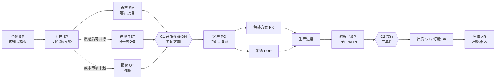

### 1.5 数据归属字段

每张业务单据都带三个归属字段，权限过滤（第 6 节）和看板统计都靠它们：〔推断〕

| 字段 | 含义 | 取值规则 |
| --- | --- | --- |
| 负责人 owner | 单据当前负责人 | 创建时默认为客户的跟单业务员（R001）；可转交，转交留痕 |
| 所属组织 org | 负责人所在组织 | 随负责人；转交时同步更新 |
| 客户 customer | 单据所属客户 | 从款或 PO 继承，不可改 |
| 经手人 participants | 处理过或被指派过待办的人 | 系统自动追加，用于「经手人可见」（6.5） |

### 1.6 主数据

主数据由 M20 维护或从内部 ERP 同步（第 7 节），业务单据只引用不复制：客户（简码、结算主体、账期、对接人）、工厂与基地（工厂主体、基地、日均产量）、针型与机台（96N / 120N / 144N / 168N / 200N，开机台数）、物料（纱线、辅料、包材）、检测机构（BV、SGS 等，服务等级与时效）、货代与船司、币种与汇率、季节、工作日历。〔视频：字段散见各页；推断：集中为主数据〕

---

## 2. 主线与节点状态计算

### 2.1 节点状态

| 状态 | 含义 | 显示 | 技术枚举 |
| --- | --- | --- | --- |
| 待启动 | 进入条件未满足 | 灰色圆点 | PENDING |
| 进行中 | 进入条件已满足、完成条件未满足 | 主色描边，卡片浅主色底 | IN_PROGRESS |
| 已完成 | 完成条件满足 | 主色实心 + 绿色标签 | DONE |
| 受阻 | 进行中，但闸门条件不满足或存在红灯巡检命中 | 红边 + 原因列表 | BLOCKED |
| 不适用 | 客户流程配置未启用该节点关联的服务模块 | 灰色虚线 | NOT_APPLICABLE |

节点状态是**推导值**，由相关单据状态推出，不允许人工直接改；要改状态就去改单据。〔推断，与技术方案 7.1 一致〕

### 2.2 推导规则

| 节点 | 进行中的条件 | 已完成的条件 | 受阻的情形 | 来源 |
| --- | --- | --- | --- | --- |
| N01 企划接入 | 企划已创建（识别中 / 提取完成） | 企划「已确认」 | 识别失败；企划确认超期红灯 | 视频 |
| N02 打样与批复 | 企划已确认（打样单已下达） | 流程要求的轮次全部「已批准」 | 打样轮次超期未出样、客户批复超期红灯 | 视频 |
| N03 测试 | 有送测单，或打样进入质检且流程启用测试服务 | 流程要求的测试项都有「有效且合格」的报告（新送测或复用） | 报告不合格待重测；送测超期红灯 | 视频 |
| N04 报价 | 打样进入「成本审核中」或已有报价轮次 | 最新一轮客户报价「已接受」 | 护栏不通过且无例外审批 | 视频 |
| N05 开发移交 ◆ | N02–N04 都已完成或不适用 | 移交包「已移交」 | G1 缺项 | 视频 |
| N06 PO 复核 | PO 已上传，订单「待确认」 | 订单进入「待排产」 | 规则包有未通过项；PO 有未关联开发资料的款 | 视频 |
| N07 辅料与包装 | 订单「待排产」 | 采购单全部下达且包装方案「已确认」 | 包装方案未确认临近验货 | 视频 |
| N08 备料与生产 | 订单「生产中」（不等 N07 完成，见下方补充规则 3） | 生产完成率 100% 且装箱单齐套 | 采购逾期未到货；工厂交期回复缺失 | 视频 |
| N09 验货与放行 ◆ | 首个验货阶段已排期 | 所有出货批次涉及的款 × 色 × 码都已放行 | G2 不满足；尾验不合格未复验 | 视频 |
| N10 出货与结算 | 首票出货单已建 | 全部出货批次「已签收」且应收全部「已收款 / 已冲抵」 | 到港未签收超期；应收逾期 | 视频 |

N03 与 N04 可以并行：打样到质检阶段就能送测，打样进入「成本审核中」就能报价。〔视频：打样标签「成本审核中」；推断：并行规则〕

补充规则（实现口径）：〔推断〕

1. **老款翻单**：款的开发移交包已「已移交」时，该款 N01–N04 中未完成的节点按已完成计（开发资料沿用），不再要求重走企划、打样、测试、报价。
2. **订单状态兜底**：订单已到「待发货」或「已完成」时，N07–N09 视为已完成；订单「已完成」时 N10 也视为已完成。用于历史订单或单据不全的导入数据。
3. **N08 进入条件**：只看订单是否「生产中」，不等 N07 完成（辅料、包装可与生产并行收尾）。
4. **N09 不适用**：客户流程未启用验货服务时，N09 为不适用。
5. **红灯只作用于进行中节点**：红灯巡检命中只会让「进行中」的节点变成受阻，不会影响待启动或已完成的节点。
6. **强制启用**：N01、N02、N05、N06、N08、N10 不受客户流程裁剪，始终启用；其余节点按客户流程配置可以为不适用。

### 2.3 一单多款的聚合

N01–N05 先按款逐个推导，再聚合到 PO：〔视频：多款 PO；推断：聚合规则〕

| 款级状态组合 | PO 节点状态 |
| --- | --- |
| 任一款受阻 | 受阻 |
| 全部款已完成或不适用 | 已完成 |
| 全部款不适用 | 不适用 |
| 全部款待启动 | 待启动 |
| 其他（部分完成、部分进行中） | 进行中，卡片显示「3 / 5 款已完成」 |

N06–N10 直接在 PO 上推导；N09 按出货批次涉及的款 × 色 × 码聚合。

### 2.4 「已完成 x / 10 · 当前节点」

- 分母固定为 10；x = 已完成节点数 + 不适用节点数（不适用节点在时间线上灰显，不让分母随客户变化）。〔视频：「已完成 5 / 10 步」；推断：不适用的计法〕
- 当前节点 = 按序号第一个状态为「进行中」或「受阻」的节点；有并行进行中的节点时，当前节点取序号最小者，卡片上注明「并行：报价」。〔推断〕
- 全部完成时显示「已完成 10 / 10 · 已闭环」。

### 2.5 时效与平均办结

- **已耗时**：节点首次进入「进行中」到现在（未完成）或到完成时刻，按自然时间计，精确到小时，显示为「10 小时」「2.8 天」。〔视频：打样阶段「实际用时 10 小时」「2.8 天」〕
- **平均办结**：同一阶段、同一工厂、近 90 天已完成记录的平均用时；样本少于 5 条时退到全集团同阶段的平均，仍不足则不显示。〔视频：「平均办结 12 小时」；推断：统计口径〕
- **慢于平均**：已耗时 > 平均办结即标红「慢于平均」。〔视频：质检用时 1.2 天、平均 1 天时显示「慢于平均」〕
- 打样单的「进度正常 / 慢于平均」标签：当前阶段慢于平均，或按剩余阶段平均用时推算会超过打样交期，即为「慢于平均」。〔视频：标签「进度正常」；推断：判定〕
- 工作日只用于客户条款明确按工作日计的时效（如检测机构「加急 · 2 个工作日」），其余时效一律按自然日。〔视频：服务等级；推断：规则〕

### 2.6 G1 开发移交「五项齐套」

| 项 | 判定口径 | 数据来源 | 不适用的情形 |
| --- | --- | --- | --- |
| ① 样品 | 客户流程要求的最后一类打样轮次（通常为 SMS 或 PP）「已批准」 | 打样轮次 | 无（打样是必选） |
| ② 报价 | 最新一轮客户报价「已接受」 | 报价轮次 | 客户流程未启用「报价与定价」 |
| ③ 测试 | 流程要求的每个测试项都有「有效且合格」的报告（可复用） | 测试报告 | 客户流程未启用「测试服务」 |
| ④ QRS | 样品库有该款 QRS 品质参考样的留存记录（位置、数量） | 样品库 | 客户流程未启用服务项「QRS 品质参考样」 |
| ⑤ 技术资料包 | 资料管理里该款的资料包已上传，且包含客户流程要求的必备文件（工艺单、纱线配置、尺寸表） | 资料管理 | 无 |

〔视频：五项名称；推断：判定口径〕

- 五项齐全才能「确认移交」；确认后生成移交包快照（各项引用的单据和版本），款的开发资料**冻结**：企划、工艺要点、纱线配置、成本版本、测试结论、资料包都变为只读。〔视频：「移交后冻结」〕
- **变更**：冻结后要改，提交「开发变更申请」（改什么、原因、影响的在途 PO），R003 审批；审批通过生成新版本并解冻对应字段，修改完成后重新冻结；系统列出引用旧版本的在途 PO，通知订单负责人确认是否需要客户重新确认。〔推断，与需求 F-M15-04 一致〕
- 流程配置可以裁剪 ③ ④（不要求测试 / QRS），但不能把五项全部裁掉，发布配置时校验。〔推断，与技术方案 7.3 一致〕

### 2.7 G2 验货放行「三条件」

| 条件 | 判定口径 | 失败时的提示样例 |
| --- | --- | --- |
| ① 终验合格 | 该批次涉及的款在终验阶段（客户叫法 FRI / FINAL / FQC）最新一轮结论「合格」 | 「INSP-2606-020 尾验第 2 轮不合格（对色不符），待整改复验」 |
| ② 测试报告有效 | 该款适用的测试报告全部在有效期内且合格；有效期按「计划出厂日」判断，而不是今天 | 「报告 SGS-25-9102 将于 2026-12-05 过期，早于计划出厂日」 |
| ③ 包装就绪 | 包装方案「已确认」（当前生效版本），且装箱单覆盖批次全部款 × 色 × 码 | 「PK-2606-009 v3 待客户确认」 |

〔视频：「三条件缺一不放行」「报告过期、尾验未通过，系统及时告警」；推断：三个条件的具体内容〕

- 初验（IPI）、中验（DPI）只记录结论，不出放行结论。〔视频：「本阶段只记录验货结果，放行以 FINAL / FRI / FQC 阶段为准」〕
- 放行粒度：同 PO 同款合并一份报告、齐色齐码；一张 PO 分批出货时可按批次放行。〔视频：放行规则；推断：分批放行〕
- 放行规则参数来自客户规则包：终验须在工厂交期前 N 天完成（视频为 15 天）、同厂同日验货上限（视频为 5 款）、合并报告规则。〔视频〕
- **让步放行**：终验不合格但客户书面同意出货时，R001 发起「让步放行」，附客户确认邮件，R003 审批后放行，验货单标记「让步」，计入看板「验货一次通过率」的未通过。〔推断〕
- **出运动作的校验**：订舱可以在放行前进行（提前锁舱位）；「装箱完成」及之后的出运节点要求该批次已放行。〔推断，与需求 F-M10-23、技术方案 7.3 一致〕

### 2.8 受阻的两种来源

1. **闸门不满足**：前置节点都完成、但闸门条件缺项（N05、N09）。
2. **红灯巡检命中**：节点关联对象上存在未关闭的红灯命中（第 5 节），节点显示受阻并列出命中项。黄灯不改变节点状态，只在卡片上显示提醒。〔推断〕

受阻原因在订单监控卡片上逐条列出，可一键转待办派给责任人。〔推断，与需求 F-M09-24 一致〕

---

## 3. 单据状态机

各状态名以 README D 节为准。每个迁移都写操作日志（第 11 节）。

### 3.1 企划

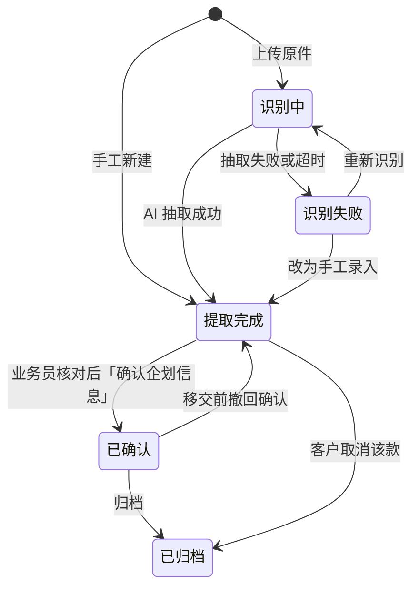

- 「确认企划信息」前，低置信度字段必须逐个过目（第 8.4 节）。〔推断〕
- 确认后自动按客户流程下达打样单（服务项决定首轮类型）。〔视频：「企划确认后，打样指令按流程自动下达」〕
- G1 移交后企划不能撤回确认，只能走开发变更。〔推断〕

### 3.2 打样轮次

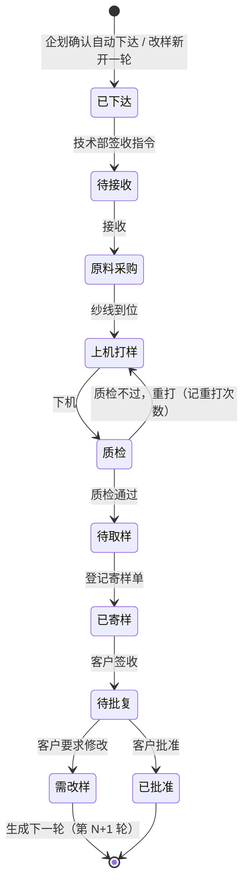

- 5 个阶段（待接收 → 原料采购 → 上机打样 → 质检 → 待取样）由技术部（R004）推进，每个阶段记录地点、完成时间、实际用时。〔视频〕
- 质检不过重打时轮次不变，「重打结转」次数 +1（视频标签「1 次重打结转」）。〔视频：标签；推断：含义〕
- 客户不需要寄实物的轮次（如照片样），「待取样」后可直接进入「待批复」。〔推断〕
- 巡检看两处停留：「已下达」停留超阈值（打样轮次超期未出样）、「待批复」停留超阈值（客户批复等待超期）。〔视频〕

### 3.3 送测单

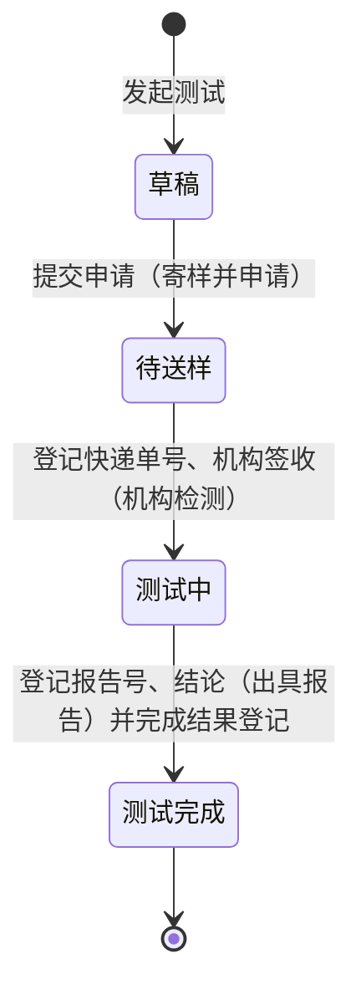

- 状态名与列表筛选「全部送测状态」取视频原值：草稿、待送样、测试中、测试完成；送测进度 4 步为「寄样并申请 → 机构检测 → 出具报告 → 结果登记」，结果登记 = 电子档案取号入共享盘并回传客户系统、纸质交授检。〔视频〕
- 结论（合格 / 不合格）是测试完成时的附加字段，不是状态；不合格时可发起重测，新送测单关联原单。〔视频：结论列；推断：重测〕
- 报告登记后生成内部报告编号 RPT-YYMM-NNN，同时保存机构报告号（BV-26-10523），在送测详情的「关联报告」表展示（报告编号、机构报告号、检测机构、检测项目、出具日、有效期至、状态）。〔视频〕

- 申请前先做复用校验：同客户、同款式结构、同工艺、测试项覆盖、报告在有效期内且合格，全部满足则提示「可复用报告 X」，用户可选择复用而不送测。复用条件按客户规则包配置（如有的客户不允许跨款复用）。〔视频：「校验报告的复用条件，减少重复送测」；推断：条件明细〕
- 「要求完成」= 机构签收日 + 服务等级时效（工作日）；超过仍未出报告触发巡检。〔视频：服务等级「加急 · 2 个工作日」〕

### 3.4 测试报告有效期

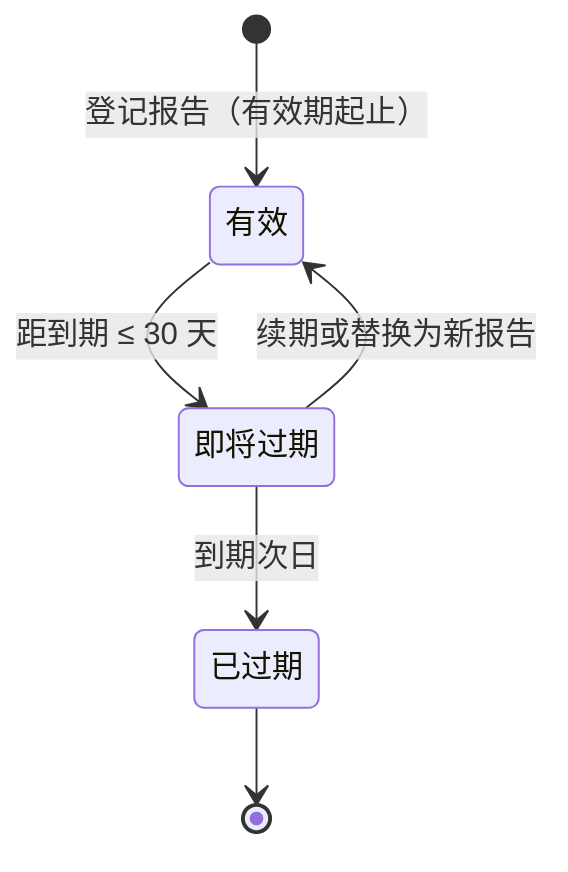

有效期默认 12 个月（视频样例 2026-12-05 → 2027-12-05），客户规则包可改。报告过期影响 N03 和 G2 条件②。〔视频：有效期；推断：默认值与阈值〕

### 3.5 报价轮次

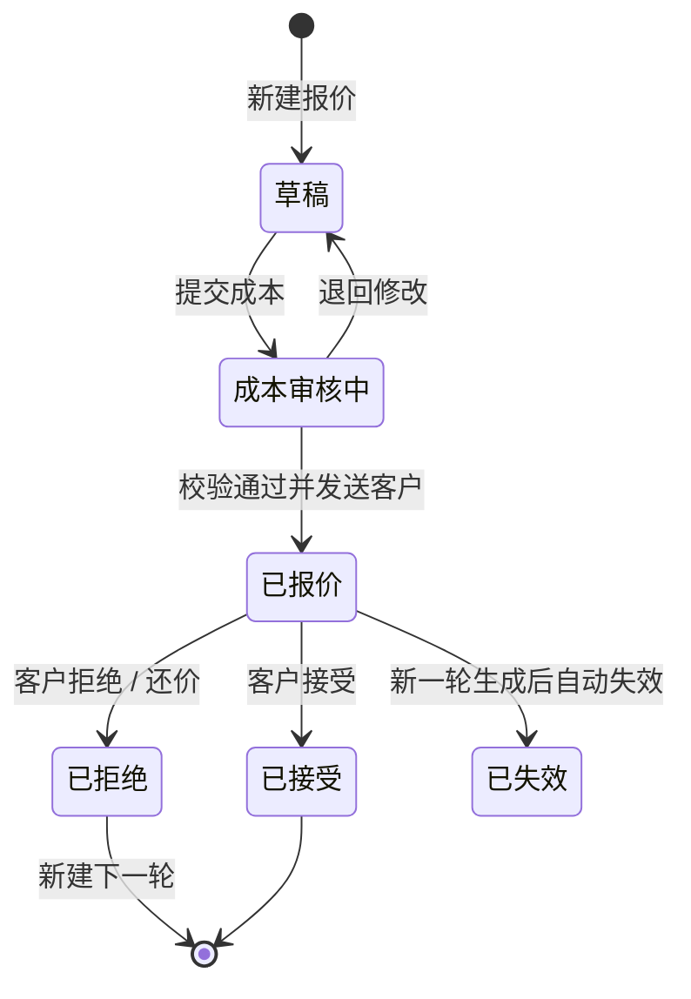

- 每轮一个报价单号（QT-12593-02、-03、-04），新一轮发出后上一轮自动「已失效」，只有最新一轮可被接受。〔视频：轮次与「最新」标签；推断：失效规则〕
- 「已报价」前强制校验毛利与护栏（第 12 节）；不通过时只能走例外审批（R002，金额大时 R003）。〔视频：「生成报价前即刻校验」；推断：例外审批〕
- 内部报价与客户报价是两条线：内部报价只在内部流转（成本审核），客户报价才计入轮次与客户比较。〔视频：页签「内部报价 1」「客户报价 3」〕

### 3.6 开发移交包

`齐套中 → 已移交（冻结）`；已移交后只能经开发变更生成新版本（2.6）。〔推断〕

### 3.7 客户订单

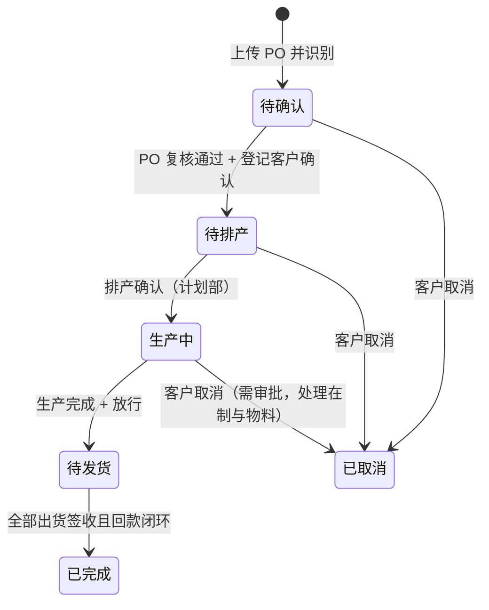

- 「第 N / 5 阶段」即上述 5 个主状态。〔视频〕
- **PO 复核规则包**（客户规则包配置）：PO 单价与已接受报价一致、数量 × 单价 = FOB 金额、付款条款与客户档案一致、交期 ≥ 下单日 + 最短生产周期、款号全部关联到开发资料、PO 与 BD（客户分配单）一致。全部通过才能「一键确认」。〔视频：「规则包校验全绿，一键确认」、服务项「PO 与 BD 一致性核对」；推断：规则明细〕
- **工厂交期回复**：每次登记生成版本（V1、V2…），延期天数 = 工厂回复交期 − 客户交期；「持平」= 0。〔视频〕
- **PO 改版**：客户发来新版本 PO（Rev.2）时，系统比对差异（数量、交期、单价、颜色尺码），订单回到「待确认」只复核差异部分；已排产后改版需计划部确认产能。〔视频：PO 版本、改版日期；推断：流程〕
- 已有出货的订单不能取消，只能对未出货部分做数量变更。〔README D 节〕

### 3.8 包装方案

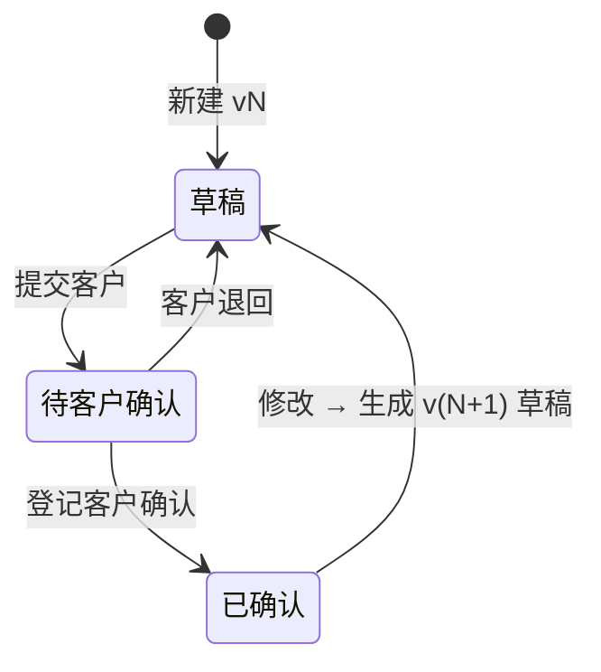

- 同一时间只有一个「当前生效版本」；修改已确认的方案生成新版本草稿，旧版本保持生效直到新版本确认。〔视频：「当前执行哪一版、客户是否确认，谁在什么时候做了修改都有记录」〕
- 装箱单引用包装方案版本；新版本确认后，未装箱的装箱单提示按新版本更新。〔推断〕

### 3.9 采购单

`已下单 → 部分到货 → 已到货`，另有「已取消」。承诺交期已过仍未全部到货触发巡检「采购逾期未到货」。〔视频：巡检命中；推断：状态〕

### 3.10 验货单

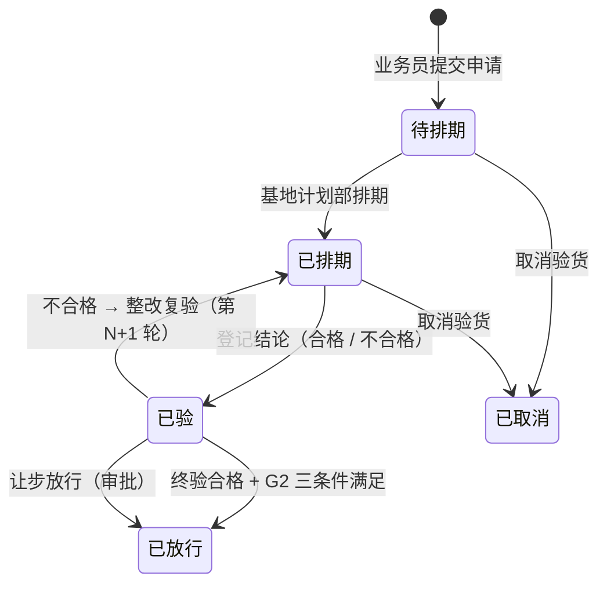

- 阶段：初期验货 IPI、中期验货 DPI、尾期验货 FRI（客户也叫 FINAL / FQC）；客户流程配置决定该客户做哪几个阶段。〔视频〕
- 只有终验阶段的验货单能到「已放行」；IPI / DPI 在「已验」结束。〔视频〕
- 排期约束：同厂同日上限（规则包，视频 5 款）、终验须在工厂交期前 N 天完成（视频 15 天）。〔视频〕
- 前置条件（尺寸表、纱线测试结果、封样扣样）不齐时不能排期。〔视频：「前置条件」字段；推断：阻止排期〕
- 不合格率 = 不合格数 ÷ 实际抽样数（视频 7 ÷ 315 = 2.2%）。〔视频〕

### 3.11 订舱与出货

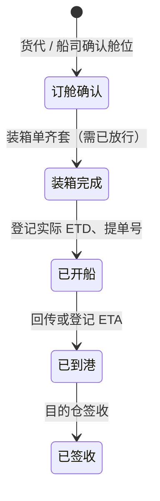

- 未发生的节点显示计划日期（「计划 2026-10-20」）。〔视频〕
- 节点信息可由货代回传（同步，第 7 节）或手工登记；回传优先，手工修改留痕。〔视频：「根据回传信息」〕
- 出货单「已开船」后按客户账期自动生成货款应收单（第 3.12 节）。〔推断〕

### 3.12 应收单

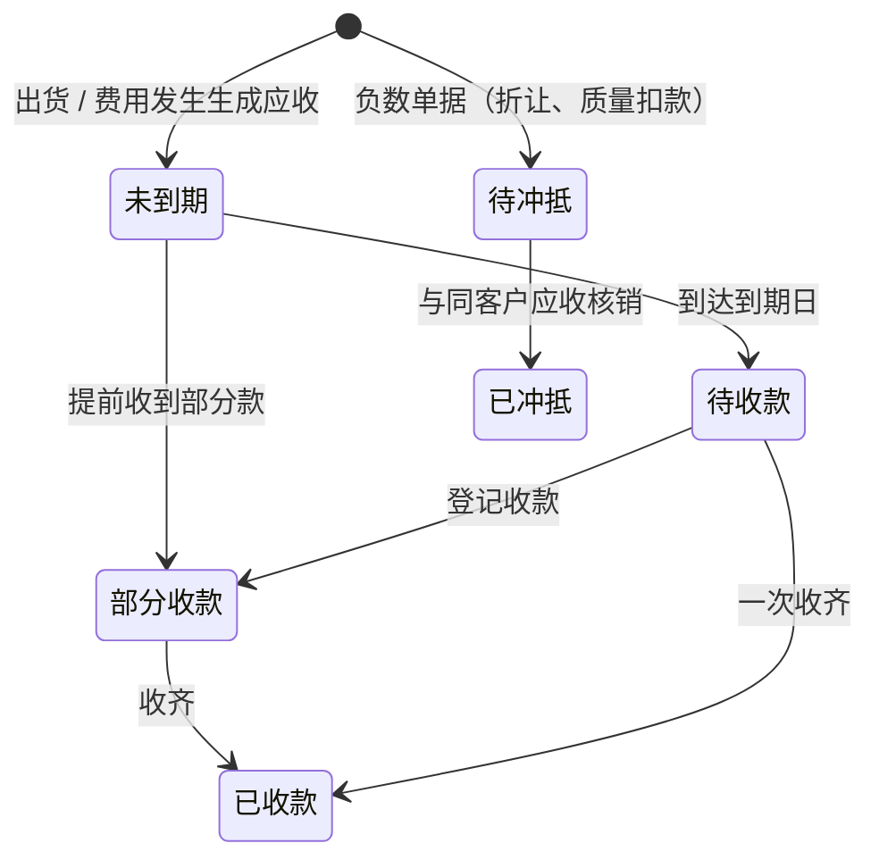

- **到期日** = 起算日 + 账期；起算日按客户条款取开船日或发票日（视频账期「月结 60 天」：起算月末 + 60 天）。〔视频：账期；推断：起算规则〕
- **逾期**是附加标记：今天 > 到期日且未收齐即逾期，逾期天数 = 今天 − 到期日；逾期当天生成催收待办。〔视频：「逾期当天就有提醒」〕
- **争议挂起**：客户对金额有异议时标记，暂停催收提醒但仍计入逾期金额。〔视频：催收工作台「争议挂起」〕
- 应收类型：货款、折让与质量扣款、运输及相关费用、检测费、辅料及包材费、样品费。〔视频〕
- 多币种分别记账，看板汇总时按月末汇率折算为人民币万元。〔视频：多币种；推断：折算〕

---

## 4. 客户流程配置模型

### 4.1 三层结构

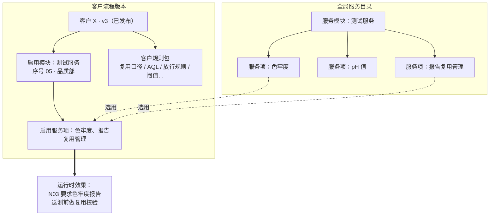

1. **服务目录**（全局）：服务模块 → 服务项。视频里 12 个模块（另有 3 个待建），每个模块有可选服务项（如打样开发 21 项）。〔视频：模块配置〕
2. **客户流程**：客户启用哪些模块（有序号、负责部门）、每个模块启用哪些服务项。〔视频：流程配置 · Bombas〕
3. **客户规则包**：客户特有的参数口径，被服务项和巡检规则引用。〔视频：「客户规则口径」；推断：独立成规则包〕

### 4.2 服务项的属性

| 属性 | 说明 |
| --- | --- |
| 编码、名称、所属模块 | 如 `test.color-fastness` 色牢度 |
| 负责部门 | 默认部门，客户流程里可改 |
| 生效类型 | 节点开关 / 子步骤 / 单据模板 / 校验规则 / 待办模板 / 同步对象（可多选） |
| 参数结构 | 该服务项需要的参数（如测试项的判定标准、验货阶段的 AQL），配置界面按参数结构自动生成表单 |
| 是否需客户确认 | 如包装方案确认、船样确认 |
| 默认值 | 新客户启用时带出的默认参数 |

〔推断，与技术方案 7.4「服务项注册表」一致〕

### 4.3 服务模块与节点的对应

| 服务模块 | 影响节点 | 可否移除 | 来源 |
| --- | --- | --- | --- |
| 企划与开发 | N01、N05 | 否（必选） | 推断 |
| 打样开发 | N02 | 否（必选） | 视频 |
| 寄样服务 | N02（寄样子步骤） | 可 | 视频 |
| 测试服务 | N03、G1 ③、G2 ② | 可，移除后 N03 不适用 | 视频 |
| 报价与定价 | N04、G1 ② | 可（如客户直接下固定价 PO），移除后 N04 不适用 | 视频 |
| 订单与生产 | N06、N08 | 否（必选） | 视频 |
| 包装服务 | N07、G2 ③ | 可 | 视频 |
| 采购与备料 | N07、N08 | 可（客供料客户） | 视频 |
| 验货服务 | N09 | 可，移除后 N09 只校验 G2 ②③ | 视频 |
| 出货与单证 | N10 | 否（必选） | 视频 |
| 结算与对账 | N10 | 否（必选） | 视频 |
| 数据同步 | 不影响节点，生成同步任务模板 | 可 | 视频 |

节点关联的模块全部未启用时，该节点为「不适用」。〔推断〕

### 4.4 服务项怎么生效（示例）

| 服务项 | 生效类型 | 运行时效果 | 来源 |
| --- | --- | --- | --- |
| 打样开发 · 颜色样 / 产前样 / QRS 品质参考样 | 单据模板 | 打样单可选的轮次类型；QRS 启用时 G1 ④ 生效 | 视频：服务项；推断：效果 |
| 寄样服务 · 客户指定货代 | 子步骤 | 寄样单必填货代账号 | 视频；推断 |
| 测试服务 · 色牢度 / pH 值 / 起毛起球 | 校验规则 | N03 完成条件里要求的测试项 | 视频；推断 |
| 测试服务 · 报告复用管理 | 校验规则 | 送测前做复用校验（3.3） | 视频 |
| 验货服务 · 初期验货 IPI / 中期验货 DPI / 尾期验货 FRI | 单据模板 | 订单进入生产后按启用阶段生成验货计划 | 视频；推断 |
| 包装服务 · 包装方案确认 | 校验规则 | G2 ③ 要求包装方案客户已确认 | 视频；推断 |
| 订单与生产 · PO 与 BD 一致性核对 | 校验规则 | PO 复核规则包加入 BD 比对 | 视频 |
| 采购与备料 · RWS 贴纸核批 | 待办模板 | 下采购单后生成「RWS 贴纸核批」待办给采购员 | 视频；推断 |
| 出货与单证 · 产地证 / Packing List / 箱唛管理 | 单据模板 | 出货单需要上传的单证清单 | 视频；推断 |
| 结算与对账 · Open Payment 跟踪 | 子步骤 | 应收单显示客户付款平台状态字段 | 视频；推断 |
| 数据同步 · 测试报告回传 / 验货申请与报告回传 | 同步对象 | 生成对应同步任务模板（第 7 节） | 视频；推断 |

### 4.5 客户规则包

| 参数 | 示例值 | 被谁使用 | 来源 |
| --- | --- | --- | --- |
| 账期与起算 | 月结 60 天，从开船日起算 | 应收到期日 | 视频：账期；推断：起算 |
| 报告复用口径 | 同款式结构 + 同工艺 + 测试项覆盖 + 有效期内；是否允许跨款 | 送测复用校验 | 视频：「客户规则口径」；推断：明细 |
| 报告有效期 | 12 个月 | 报告状态 | 视频：样例；推断 |
| PO 复核规则 | 3.7 所列规则的启停与容差（如单价容差 0） | N06 | 推断 |
| 验货阶段与 AQL | IPI + DPI + FRI，AQL 1.5 Level I | 验货计划 | 视频 |
| 放行规则 | 终验在工厂交期前 15 天完成；同 PO 同款合并报告、齐色齐码；同厂同日上限 5 款 | G2、排期 | 视频 |
| 时效阈值 | 打样轮次停留 7 天、客户批复等待 5 天 | 巡检规则覆盖值 | 视频 |
| 包装要求 | 每箱双数、纸箱规格、箱唛规范 | 包装方案默认值 | 视频；推断 |
| 对账周期 | 每月 5 日出对账单 | 催收工作台导出 | 推断 |

### 4.6 版本与生效

- 配置在草稿上编辑，「发布」生成不可变的客户流程版本（v1、v2…），记录发布人、时间、变更摘要。〔推断，与技术方案 7.4 一致〕
- **绑定时机**：款在企划确认时绑定当时的发布版本；订单在 PO 确认时绑定。之后改配置**只影响新单**；在途单据如要切换，由管理员执行「迁移到新版本」，系统先列出迁移影响（新增 / 取消的节点、新增的校验），确认后迁移并记审计。〔推断，与需求 F-M19-08 一致〕
- 配置可回退：以历史版本为内容新建一个版本并发布（第 11 节）。

### 4.7 「新增客户无需写代码」的边界

| 无需开发（配置即可） | 需要开发 |
| --- | --- |
| 复制已有客户流程作为模板，增删模块和服务项、调序、改负责部门 | 新增一种服务项**类型**（如一种全新的单证或校验算法） |
| 调整规则包参数（阈值、AQL、账期、复用口径） | 新增一类单据或一个新节点 |
| 启停巡检规则、改阈值、按客户覆盖 | 对接一个新的客户系统协议（新适配器） |
| 配置同步任务（已有适配器的对端） | 新的看板指标 |

〔视频：「客户新增，无需编写代码」；推断：边界〕

---

## 5. 巡检规则引擎

### 5.1 概念

- **巡检规则**（IR-NNN）：一条「什么对象、在什么条件下、超过什么阈值就算异常」的定义。
- **巡检任务**（PT-NNNN）：一次执行，记录触发方式（自动 / 手动）、开始时间、耗时、命中数。〔视频：PT-0001 自动 289 ms、PT-0002 手动 274 ms〕
- **命中**：某条规则在某个对象上成立一次；命中带灯色、严重度、判定说明、责任人，并生成待办。〔视频〕

### 5.2 规则结构

| 字段 | 说明 | 来源 |
| --- | --- | --- |
| 编号、名称 | IR-001「打样轮次超期未出样」 | 视频：名称；推断：编号 |
| 所属模块 | 8 个业务模块之一（5.4） | 视频 |
| 对象类型 | 打样轮次、送测单、采购单、验货单… | 视频 |
| 判定类型 | 停留型（某状态停留天数）/ 截止型（距截止日天数）/ 缺失型（到点缺要素） | 推断 |
| 阈值 T | 停留或逾期的天数上限，如 7 天 | 视频 |
| 预警窗口 W | 黄灯提前量，如 2 天 | 推断 |
| 默认严重度 | 高 / 中 / 低 | 视频 |
| 责任角色 | 命中后派给谁（单据负责人或某角色） | 视频 |
| 适用客户 | 全部或指定客户；可按客户覆盖阈值（取客户规则包） | 推断 |
| 启用状态 | 启用 / 停用 | 推断 |

### 5.3 灯色与严重度

| 判定类型 | 红灯 | 黄灯 | 判定说明样例 |
| --- | --- | --- | --- |
| 停留型（停留 d 天） | d > T | T − W < d ≤ T | 「轮次停留在『已下达』已 142 天（阈值 7 天）」 |
| 截止型（剩余 r 天） | r < 0 | 0 ≤ r ≤ W | 「承诺交期 2026-09-20 已过 31 天」 |
| 缺失型 | 到检查时点仍缺 | 距检查时点 ≤ W 天仍缺 | 「验货前置条件缺尺寸表，排期日 10-24」 |

- 绿灯是**模块级**的：本次执行某模块没有任何命中，该模块记为绿灯。〔视频：「绿灯 3 个模块 · 扫过 8 个模块无命中」〕
- 严重度取规则默认；红灯逾期超过 2T 自动升一级（中 → 高）。〔视频：高 / 中；推断：升级规则〕

### 5.4 首版 18 条规则（覆盖 8 个模块）

8 个模块：企划、样品、报价、测试、订单、采购、验货、出货。〔视频：「八个业务模块」；推断：具体模块，与需求 F-M16-04 一致〕

| 编号 | 模块 | 规则 | 对象 | 判定 | 阈值 / 窗口 | 严重度 | 派给 | 来源 |
| --- | --- | --- | --- | --- | --- | --- | --- | --- |
| IR-001 | 企划 | 企划识别超时 | 企划 | 停留「识别中」 | 2 小时 / — | 中 | R001 | 推断 |
| IR-002 | 企划 | 企划确认超期 | 企划 | 停留「提取完成」 | 3 天 / 1 天 | 中 | R001 | 推断 |
| IR-003 | 企划 | 开发移交缺项 | 款 | N02–N04 完成后 G1 仍缺项 | 3 天 / 1 天 | 高 | R001 | 推断 |
| IR-004 | 样品 | 打样轮次超期未出样 | 打样轮次 | 停留「已下达」 | 7 天 / 2 天 | 高 | R001 | 视频 |
| IR-005 | 样品 | 客户批复等待超期 | 打样轮次 | 停留「待批复」 | 5 天 / 1 天 | 中 | R001 | 视频 |
| IR-006 | 报价 | 报价超期未反馈 | 报价轮次 | 停留「已报价」 | 10 天 / 3 天 | 中 | R001 | 推断 |
| IR-007 | 测试 | 送测超期未出报告 | 送测单 | 超过「要求完成」日 | 0 天 / 1 天 | 高 | R005 | 视频 |
| IR-008 | 测试 | 测试报告即将过期 | 测试报告 | 有在途 PO 引用且距到期 | 30 天内为黄、过期为红 | 中 | R005 | 推断 |
| IR-009 | 订单 | PO 待复核超期 | 客户订单 | 停留「待确认」 | 3 天 / 1 天 | 高 | R001 | 推断 |
| IR-010 | 订单 | 工厂交期回复缺失 | 客户订单 | 「待确认」超过 2 天仍无工厂回复 | 2 天 / 1 天 | 中 | R006 | 推断 |
| IR-011 | 订单 | 台账更新逾期 | 台账更新任务 | 超过「下次更新」日 | 0 天 / 1 天 | 中 | R006 | 视频：「已逾期」任务；推断：归入订单模块 |
| IR-012 | 采购 | 采购逾期未到货 | 采购单 | 超过承诺交期仍未全部到货 | 0 天 / 3 天 | 高 | R007 | 视频 |
| IR-013 | 验货 | 包装方案未确认临近验货 | 包装方案 | 终验计划日前仍未「已确认」 | 7 天 / 3 天 | 中 | R001 | 推断 |
| IR-014 | 验货 | 验货前置条件缺失 | 验货单 | 排期日前前置条件不齐 | 缺失型 / 2 天 | 中 | R005 | 视频：前置条件字段；推断 |
| IR-015 | 验货 | 尾验不合格未复验 | 验货单 | 终验不合格后未排复验 | 2 天 / — | 高 | R001 | 视频：「尾验未通过，系统及时告警」 |
| IR-016 | 验货 | 终验排期晚于交期前 15 天 | 验货单 | 终验计划日 > 工厂交期 − N（规则包） | 截止型 / 3 天 | 中 | R006 | 视频：放行规则 |
| IR-017 | 出货 | 订舱船期已过未开船 | 订舱单 | 计划 ETD 已过仍未「已开船」 | 0 天 / 2 天 | 高 | R008 | 视频：「订舱 BK-2606-003 船期 已超 21 天」 |
| IR-018 | 出货 | 到港未签收超期 | 出货单 | 「已到港」停留 | 7 天 / 2 天 | 中 | R008 | 视频：「哪几票尚未签收」；推断：阈值 |

应收逾期不放进巡检，由应收自身的逾期标记和催收待办处理（第 10 节），避免重复派单。〔推断〕

### 5.5 执行

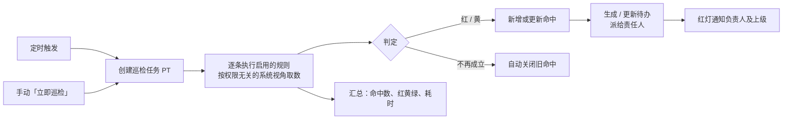

- **频率**：每天凌晨全量一次（视频 PT-0001 执行于 00:54），白天按固定间隔增量执行；间隔在系统参数里配置。默认值以技术方案 8.2 为准。〔视频：自动任务；推断：频率〕
- **手动**：「立即巡检」立刻执行全量；同一时刻只允许一个全量任务，重复点击返回正在执行的任务号。〔视频：按钮；推断：并发规则〕
- 巡检用系统视角取全量数据，但命中明细页按查看人的权限过滤显示。〔推断〕

### 5.6 命中的生命周期

- **去重键** = 规则 + 对象。同一对象同一规则只保留一条未关闭命中；再次命中只更新灯色、天数和最后命中时间。〔推断，与技术方案 8.3 一致〕
- **自动关闭**：下次执行时条件不再成立（如已出样、已收到报告），命中自动关闭，对应待办同步完成。
- **手动关闭**：责任人可标记「误报」或「已线下处理」，必须填原因；手动关闭后静默 3 天，期间不再派单，到期仍成立则重新打开。〔推断〕
- 命中处理状态：待处理 → 处理中（责任人点开「去处理」）→ 已关闭。〔README D 节〕

### 5.7 派单与升级

- 派单对象：规则配置为「单据负责人」时派给单据 owner；配置为角色时，派给对象所属组织内该角色的成员（多人时派给组织负责人分配）。〔视频：「待办事项指派到人」、严重度旁的「业务员 / 采购员」〕
- 红灯：通知负责人和其直属经理（R002）。红灯 3 天未处理，再通知 R003。〔推断〕
- 命中明细「去处理」直接跳到对象详情页，并在页面顶部显示命中说明。〔视频：「去处理」；推断：页面提示〕

---

## 6. 权限模型

### 6.1 三维取交集

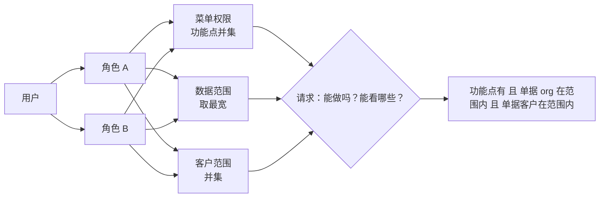

一个操作要同时满足：有该功能点（菜单 / 按钮）、单据在数据范围内、单据客户在客户范围内。〔视频：「从菜单、组织和客户三个维度配置权限」〕

### 6.2 菜单权限

- 菜单级权限项对应左侧菜单的叶子节点（视频「菜单权限项 61 项」）；按钮级权限挂在菜单下，如「登记放行」「推进到待排产」「归档」「导出」「查看成本」。〔视频：61 项；推断：按钮级〕
- 权限弹窗按模块分组展示，每组可全选。〔视频〕

### 6.3 数据范围

| 档位 | 能看哪些单据 | 适用角色 | 来源 |
| --- | --- | --- | --- |
| 仅本人 | owner 是自己的单据 + 经手的单据（6.5） | R001 业务员 | 视频 |
| 本组织 | org 是自己所在组织的单据 | R004、R005、R007、R008、R009、R010 | 推断 |
| 本组织及下级 | org 是本组织或任一下级组织的单据 | R002 业务经理、R006 计划员 | 视频 |
| 全部数据 | 全部单据 | R003 业务总经理、R090 系统管理员 | 视频 |

- 用户有多个角色时，数据范围取最宽的一档。〔推断，与技术方案 11.2 一致〕
- 单据转交给别人后，原负责人失去「仅本人」可见性（除非仍是经手人）。〔推断〕
- **职能部门可见**（2026-11-15 开发中补充）：业务单据的 org 是业务部门，「本组织」对技术、品质、计划、采购、关务、财务、生产等职能部门没有意义——它们要办理的单据都挂在业务部门名下。规则：组织带「职能」属性（销售 / 管理 / 技术 / 品质 / 计划 / 采购 / 关务 / 财务 / 生产 / 信息）；数据范围为「本组织」或「本组织及下级」且所在组织职能不是销售或管理的用户，**不按组织过滤，只按客户范围过滤**；能看哪类单据、能做哪些动作仍由菜单与按钮权限决定。销售部门与管理层的数据范围语义不变。实现见 `apps/api/src/core/access/scope.ts`。〔推断〕

### 6.4 客户范围

- 角色上配置可见客户清单（视频 R001 可见 Bombas、优衣库、迪卡侬等 13 家）或「全部客户」；R002、R003 视频显示「未授权」，理解为不按客户限制、只按组织限制。〔视频：客户范围列；推断：「未授权」的含义〕
- 客户范围同时过滤：列表、详情、看板统计、全局搜索、AI 助手可用数据。〔推断〕

### 6.5 经手人可见

主线跨部门协作：品质员要看订单的款和交期，计划员要看订单数量，财务要看出货单。规则：〔推断〕

- 被指派过该单据待办、或在该单据上做过操作的人，对该单据**只读可见**，不受数据范围限制，但仍受客户范围和字段级权限限制。
- 经手可见延伸到该单据的直接上游（如验货单经手人可看对应 PO 的基础信息），不延伸到下游。

### 6.6 字段级敏感数据

| 字段组 | 需要的权限 | 默认拥有 |
| --- | --- | --- |
| 成本构成、成本合计、内部报价、毛利率、护栏 | 查看成本 | R001（本人款）、R002、R003 |
| 客户目标价、报价策略参数 | 查看报价策略 | R001、R002、R003 |
| 应收金额、收款记录 | 查看应收 | R001（本人客户）、R002、R003、R009 |
| 对端系统凭据 | 管理凭据 | R090 |

没有权限时接口不返回这些字段，界面不显示该字段（不显示「***」占位）；AI 助手的工具结果同样裁剪。〔推断，与技术方案 11.4 一致；界面设计 7.7 中的「***」应同步改为隐藏〕

### 6.7 视频中的角色配置

| 编码 | 角色 | 类型 | 数据范围 | 客户范围 | 菜单权限 | 账号数 |
| --- | --- | --- | --- | --- | --- | --- |
| R001 | 业务员 | 业务角色 | 仅本人 | 13 家客户 | 48 / 61 | 26 |
| R002 | 业务经理 | 管理角色 | 本组织及下级 | 不限 | 52 / 61 | 13 |
| R003 | 业务总经理 | 管理角色 | 全部数据 | 不限 | 61 / 61 | 3 |

〔视频〕

### 6.8 其他规则

- **系统管理员**（R090）可管理组织、用户、角色、配置，但默认**不**拥有查看成本和应收的权限，需单独授权，体现职责分离。〔推断〕
- **授权变更**（角色权限、成员、客户范围）都是关键变更，记录前后差异，可回退（第 11 节）。〔视频：「数据操作都有记录，关键变更可回退」〕
- **离职交接**：停用用户前必须把其负责的在途单据批量转交，系统列出待转交清单。〔推断〕

---

## 7. 主数据适配器与同步

### 7.1 两类对端

| 对端 | 典型系统 | 方向 | 同步对象 | 主从关系 | 来源 |
| --- | --- | --- | --- | --- | --- |
| 内部 ERP | 环思等纺织服装 ERP | 主要拉取 | 客户、物料、工厂、日均产量、未生产订单量、生产进度、发票 | 主数据以 ERP 为准 | 视频：旁白「环思系统」、产能台账「（同步）」 |
| 客户系统 | 客户的供应商平台（视频 SPL） | 主要推送 | 订单交期、测试报告、验货申请与报告、TNA、款式资料 | 业务单据以 OTD 为准 | 视频：SYN-2026-011、数据同步服务项 |

旁白讲的是 ERP，画面演示的是客户系统，两类都要支持。〔视频〕

### 7.2 对象关系

`对端系统 → 同步任务 → 字段映射 → 执行（批次）→ 记录结果 → 重试队列`。一个对端可有多个同步任务；一个任务只同步一类对象、一个方向。〔视频：任务字段；推断：一对象一方向〕

### 7.3 字段映射

| 映射类型 | 说明 | 样例 |
| --- | --- | --- |
| 字段对应 | 源字段 → 目标字段 | `factory_due_date` → `ShipDate` |
| 格式转换 | 日期、数字、单位 | 日期统一 `YYYY-MM-DD`（视频失败明细的处理建议） |
| 码表映射 | 两侧编码不同的枚举 | 客户编码、尺码（S/M/L ↔ 01/02/03）、颜色、币种 |
| 常量 / 默认值 | 对端必填但本系统没有的字段 | 供应商代码固定值 |
| 表达式 | 简单计算或拼接 | 品号 = 简码 + 款号 + 季节 |

- **不改对端字段**：适配器只通过对端已有的接口、视图或文件格式读写，不要求对端加字段；本系统缺的字段用常量或码表补，多出的字段丢弃。〔视频：「在不改变环思系统字段前提下」〕
- 码表未命中是最常见的失败（视频备注「少量记录因编码映射未命中失败」），映射页要能直接从失败记录一键补码表。〔视频：备注；推断：一键补〕

### 7.4 方向、模式、触发

- **方向**：拉取（对端 → OTD）/ 推送（OTD → 对端）。
- **模式**：全量 / 增量。增量用水位线（上次成功同步到的更新时间或对端序号），只有批次全部成功或失败记录已入重试队列后才推进水位线。〔视频：增量同步；推断：水位线规则〕
- **触发**：定时（如「每半天一次」）/ 手动「立即执行」/ 事件（如订单交期变更后推送）。〔视频：定时、立即执行；推断：事件〕

### 7.5 执行、批次与结果

- 一次执行拆成多个批次（视频 B01–B04，每批 373 条），每批记录开始时间、耗时、记录数、成功、失败、跳过。批大小按任务配置（1–1000），默认每批 100 条。〔视频；推断：默认批大小〕
- **跳过**：对端已是最新值、或记录不在本任务范围内。〔推断〕
- **执行结果**：全部成功 = 成功；有失败但不全失败 = 部分成功；全部失败或任务异常中断 = 失败。〔视频：「部分成功」〕
- 执行过程三步：开始执行 → 执行结果 → 日志同步（结果写回日志）。〔视频〕

### 7.6 失败分类与重试

| 错误类型 | 样例原因 | 处理建议 | 自动重试 | 来源 |
| --- | --- | --- | --- | --- |
| 接口超时 | 外部系统 30 秒内未返回结果 | 链路重试；连续超时联系对方系统运维 | 是 | 视频 |
| 限流 / 对端 5xx | 对端返回 429 / 503 | 等待后重试 | 是 | 推断 |
| 格式不符 | 来源日期格式与目标不一致 | 在转换规则里统一为 YYYY-MM-DD | 否 | 视频 |
| 映射未命中 | 尺码 XL2 无对应编码 | 补充码表后手动重试 | 否 | 视频：备注 |
| 必填缺失 / 业务校验失败 | 交期为空 | 补数据后手动重试 | 否 | 推断 |

- 可自动重试的失败进入重试队列，按 1 分钟、5 分钟、30 分钟、2 小时、12 小时退避，最多 5 次；超过上限转人工并通知负责人。〔视频：「失败记录进入重试队列」；推断：退避，与技术方案 10.4 一致〕
- 不自动重试的失败等人修好映射或数据后点「重试失败记录」。〔视频：按钮〕
- 任务连续 3 次整体失败自动停用并通知负责人。〔推断，与技术方案 10.4 一致〕
- 推送带幂等键，重试不会在对端重复创建。〔推断〕

### 7.7 样例：SYN-2026-011

UQL 订单交期同步（OTD 平台 → 客户系统 SPL）：推送、增量、定时每半天一次，负责人为生管。最近一次 4 个批次（B01–B04）每批 373 条，B04 失败 2 条（接口超时 1 条、日期格式不符 1 条），失败记录已进重试队列，状态「部分成功」。〔视频〕操作日志写「成功 1,488 条，失败 2 条」，与批次合计 1,492 条差 2 条，是演示数据本身的出入；实现时任务汇总必须等于批次之和。演示数据用虚构客户：对应的样例任务是「NSR 订单交期同步（OTD 平台 → 客户系统）」，对端为模拟的 NSR 客户系统。

### 7.8 冲突处理

- 主数据（客户、物料、工厂）以 ERP 为准，OTD 内只读；本地需要补充的字段（如客户对接人）存在扩展表，不回写 ERP。〔推断〕
- 业务单据以 OTD 为准；对端回传的状态（如货代回传 ETA）只更新约定字段，人工修改过的字段不被回传覆盖，冲突时生成待办让负责人选择。〔推断〕

---

## 8. AI 助手

### 8.1 能力

| 能力 | 做什么 | 示例 | 来源 |
| --- | --- | --- | --- |
| 查资料 | 检索内部知识库（客户手册、工艺标准、资料包） | 「这个客户的箱唛要求是什么」 | 视频 |
| 问进度 | 查询业务数据并汇总 | 「现在手上有多少张客户订单」→ 18 张、285,631 双、$461,004.5 | 视频 |
| 分析问题 | 基于数据给结论与建议 | 客户集中度、未来 8 周交期压力、逾期结构；看板智能诊断 | 视频 |
| 辅助处理任务 | 起草与预填，需人工确认 | 起草催收邮件、生成待办、预填单据草稿 | 视频：「辅助处理业务任务」；推断：范围 |
| 文档抽取与翻译 | 企划原件、PO 的要素抽取和英译中（后台任务） | 「AW26 企划 · Agent 提取要素并翻译」 | 视频 |

### 8.2 权限边界

- 助手以**当前用户的身份**取数：所有工具都调用带权限注入的业务查询接口，助手拿到的数据与用户在页面上能看到的一致（菜单 × 数据范围 × 客户范围 × 字段权限）。〔视频：「授权业务数据」〕
- 用户问到无权查看的内容，回答「无权查看」，不透露数量或存在性。〔推断〕
- 知识库文档也有可见范围（如某客户的手册只对有该客户范围的人可见）。〔推断〕

### 8.3 回答协议

- 基于业务数据的回答必须在末尾注明**数据来源与截止时间**，如「订单管理 · 客户订单 · 截至 2026-10-21」。〔视频〕
- 回答可包含结构化卡片：KPI 行、高亮提示（「待确认 3 张」）、条形图（按客户分布）、折线图（未来 8 周交期压力，带均值线）、表格、跳转按钮（「查看订单列表」）、文字结论。〔视频〕
- 数字只能来自工具返回的数据，不允许模型自行估算；没有数据就说没有。〔推断〕

### 8.4 企划原件与 PO 的抽取


- 抽取目标：企划 → 中英文名、客户、品类 / 子类、尺码段、针数、袜重、要求样期、产品属性（针筒、罗口、脚底缓冲、跟部、袜头缝、左右脚区分）、图片；PO → PO 号、版本、买方主体、款号 × 颜色 × 尺码 × 数量、单价、贸易术语、付款条款、交期、目的地、运输方式。〔视频：企划详情与订单详情字段〕
- 原文、原图与译文同时保留，详情页可对照查看。〔视频：「原文与图片同步保留」〕
- 置信度低于阈值的字段黄色标出；客户 Tech Pack 没填的字段留空并注明「客户未填」。〔视频：「空项为客户未填」；推断：置信度〕
- PO 识别完成后订单进入「待确认」，自动跑 PO 复核规则包（3.7）。〔视频：「上传客户 PO 并识别字段，进入『待确认』」〕

### 8.5 辅助操作与人工确认

- 助手可以**准备**写操作（起草邮件、预填单据、生成待办），但不能直接执行；界面显示确认卡（要做什么、影响哪些对象、预览内容），用户点确认后才由系统以用户身份执行。〔推断〕
- 执行的操作记入操作日志，来源标记「AI 助手」，并记录对应的会话。〔推断〕
- 不能做的事：审批、放行、确认收款、改权限、改配置、删除数据、对外发送（邮件只起草，由用户自己发）。〔推断〕

### 8.6 看板智能诊断

每个看板顶部的「小达诊断」（通用版叫「智能诊断」）由助手按看板数据生成：结论按影响排序，每条带「优先处理 / 建议关注」标签和依据数字。生成规则见 9.4。〔视频〕

### 8.7 会话

- 会话列表显示标题（首个问题）、时间、条数；可新建、删除。会话保存 180 天。〔视频：最近会话；推断：保存期，与需求 F-M01-11 一致〕
- 悬浮助手打开时自动带上当前页面的单据作为上下文（如在 PO 详情页问「这单卡在哪」）。〔推断，与需求 F-M01-08 一致〕

---

## 9. 看板指标口径

### 9.1 通用口径

- **时间**：按所选期间（本月 / 本季 / 本年 / 自定义）；「到期」类指标按截止日落在期间内计，「完成」类按完成时间落在期间内计。〔推断〕
- **范围**：按查看人的数据范围和客户范围计算，同一指标不同人看到的数可能不同。〔推断〕
- **金额**：总经理、经理看板用人民币万元，外币按当月月末汇率折算；业务看板不显示金额。〔视频：「万元」；推断：折算〕
- **刷新**：每小时刷新一次，卡片显示数据截点（视频「数据截点 2026-10-21」）。〔视频；推断：频率〕
- 每个 KPI 的定义、公式、来源都能在「指标口径」里查到。〔视频：按钮〕

### 9.2 三个看板的 KPI

下表用视频里的数字验算公式，「✓」表示数字对得上。

| 看板 | KPI | 公式 | 视频验算 |
| --- | --- | --- | --- |
| 业务 | 应完成任务 | 截止日在期间内、分配给本人的待办数 | 98 |
| 业务 | 任务完成率 | 应完成任务中已完成数 ÷ 应完成任务 | 77 ÷ 98 = 78.6% ✓ |
| 业务 | 按时完成率 | 应完成任务中按时完成数 ÷ 应完成任务 | 49 ÷ 98 = 50.0% ✓ |
| 业务 | 到期未完成 | 截至数据截点已到期、未完成的待办数 | 98 − 77 = 21 ✓ |
| 业务 | 平均处理周期 | 期间内完成的待办（含非本期到期的），从创建到完成的平均天数 | 88 项平均 7.1 天 |
| 业务 | 返工率 | 期间内完成的待办中被退回重做的数 ÷ 期间内完成数 | 12 ÷ 88 = 13.6% ✓ |
| 经理 | 部门客户 | 本组织及下级负责的客户数 | 4 |
| 经理 | 高风险客户 | 满足风险规则的客户数（9.3） | 3 |
| 经理 | 关注客户 | 临近风险或有待客户反馈事项的客户数 | 1 |
| 经理 | 逾期应收（万元） | 已逾期未收应收金额合计 | 123.0 |
| 经理 | 账龄超 30 天应收（万元） | 逾期超过 30 天的应收合计 | 84.2 |
| 经理 | 交期变更率 | 期间内确认的订单中发生过交期变更的数 ÷ 确认订单数 | 8 ÷ 28 = 28.6% ✓ |
| 总经理 | 确认订单额（万元） | 期间内进入「待排产」的订单 FOB 金额合计；副标题为目标达成率 | 1305.0 ÷ 1302.0 = 100.2% ✓ |
| 总经理 | 已交付金额（万元） | 期间内已开船出货的金额；副标题为毛利率 | 1437.0，毛利率 22.1% |
| 总经理 | 回款金额（万元） | 期间内收款合计；回款率 = 回款 ÷ 已交付 | 669.2 ÷ 1437.0 = 46.6% ✓ |
| 总经理 | 准时交付率 | 期间内应交订单中按客户交期（含）前开船的订单数 ÷ 应交订单数 | 33 ÷ 68 = 48.5% ✓ |
| 总经理 | 在手风险金额（万元） | 在手订单中节点受阻或有红灯命中的订单金额合计 | 1338.0，54 张 |
| 总经理 | 履约指数 | （订舱及时率 + 验货一次通过率 + 齐料率 + 准时交付率）÷ 4 | (62.5 + 77.8 + 81.8 + 48.5) ÷ 4 = 67.7% ✓ |

〔视频：指标名称与数字；推断：公式（由数字反推验证）〕

- 履约指数的第四项视频写「交付」，按数字反推就是准时交付率 48.5%。〔视频 + 推断〕
- 订舱及时率 = 计划 ETD 前 N 天（规则包，默认 14 天）内完成订舱确认的出货批次占比；验货一次通过率 = 终验首轮即合格的验货单占比；齐料率 = 计划开机日前物料全部到货的订单占比。〔推断〕

### 9.3 客户健康度

经理看板「部门客户健康度表」按客户打分：〔视频：高风险 / 关注 / 稳定；推断：规则〕

| 等级 | 规则（满足任一） |
| --- | --- |
| 高风险 | 逾期订单 ≥ 2 张；或未关闭质量问题 ≥ 3 个；或逾期应收 ≥ 20 万元 |
| 关注 | 有临近交期的风险订单；或待客户反馈事项超阈值 |
| 稳定 | 其余 |

视频里的诊断原文「Bombas（6 单逾期，占在手 26.1%）、6 项质量问题未关闭、逾期应收 17.6 万元」就是这几项依据。

### 9.4 智能诊断的生成规则

1. 先算规则化的「信号」：指标低于目标或阈值、环比恶化超过 10 个百分点、单一客户集中度超过 30%、逾期金额集中在少数客户等。〔推断〕
2. 按影响金额或影响单数排序，取前 6 条。〔视频：「6 条」〕
3. 「优先处理」：涉及逾期应收、逾期订单、红灯风险的信号；「建议关注」：其余。〔视频：两类标签；推断：划分〕
4. 每条写「结论（带数字）+ 建议动作 + 依据」，如「准时交付率 48.5%（33/68）……建议把订舱节点前置到 ETD 前 14 天并设预警」。〔视频〕
5. 文字由 AI 根据信号生成，数字必须来自信号数据，不允许改写数字。每日生成一次，可手动重新生成。〔推断，与需求 F-M17-08 一致〕

---

## 10. 待办与通知

### 10.1 待办来源

| 来源 | 何时生成 | 何时关闭 | 来源说明 |
| --- | --- | --- | --- |
| 流程待办 | 单据进入某状态时，按客户流程配置的待办模板生成（如企划提取完成 → 「复核企划要素」给 R001） | 单据离开该状态 | 视频：「复核企划要素」「安排送测」「确认订舱」「登记验货结果」 |
| 巡检待办 | 巡检命中（第 5 节） | 命中关闭 | 视频 |
| 催收待办 | 应收逾期当天、下次跟进日当天 | 记录催收或收齐 | 视频：「今日待跟进」 |
| 审批待办 | 例外审批、开发变更、让步放行、取消订单 | 审批完成 | 推断 |
| 手工待办 | 用户自建或助手起草后用户确认 | 手工完成 | 推断 |

### 10.2 截止与逾期

- 每条待办有截止时间（日期或日期 + 时刻，如「今日 18:00 截止」）。截止时间来自规则：如「复核企划要素」= 提取完成 + 2 天，「登记验货结果」= 实际验货日 + 1 天。〔视频：截止样式；推断：规则〕
- 「任务逾期 N 天」= 今天 − 截止日（自然日）。〔视频〕
- 今日待办分三组：**已逾期**（截止 < 今天）、**今日到期**（截止 = 今天）、**后续待办**（截止 > 今天，默认显示 6 条，「展开全部」）。〔视频〕

### 10.3 今日待办页的固定口径

| 卡片 | 口径 |
| --- | --- |
| 待办事项 | 本人未完成待办总数，副标题按来源模块拆分（订单 3 · 企划打样 15 · 测试送测 8 · 包装 4…） |
| 在手订单 | 本人范围内状态为待确认 / 待排产 / 生产中 / 待发货的订单数 |
| 打样进行中 | 本人范围内未批准的打样款数 |
| 近期交期 | 未来 30 天到期（含已超期未完成）的交期事项数：客户交期、工厂交期、船期、终验计划 |
| 今日重点关注 | 待确认订单、待船司确认订舱、待发货订单、逾期风险订单（有红灯的在手订单） |
| 近期交期提醒 | 按超期天数倒序列出交期事项（「订舱 BK-2606-003 船期 已超 21 天」） |

〔视频：卡片与数字；推断：口径〕

### 10.4 通知

- 站内通知（顶栏铃铛）：待办派给自己、红灯命中、审批结果、被 @、AI 后台任务（企划识别、同步）完成。〔视频：铃铛角标；推断：事件〕
- 外部渠道（企业微信 / 钉钉 / 邮件）可选，用户在个人设置里按事件类型订阅；红灯和审批默认开启。〔推断〕
- 同一对象同一事件 1 小时内只通知一次，避免轰炸。〔推断〕

---

## 11. 审计与关键变更回退

### 11.1 操作日志

- 记录：谁（用户、角色）、何时、从哪（IP、终端）、做了什么（动作、对象、单号）、改了什么（只记变化字段的前后值）、来源（页面 / AI 助手 / 同步 / 巡检）。〔视频：「数据操作都有记录」；推断：字段〕
- 范围：所有单据的创建、状态迁移、字段修改、删除；登录、导出、权限与配置变更、凭据修改、AI 外发。〔推断〕
- 日志只能追加，不能修改或删除；默认保留 3 年。〔推断，与技术方案 12.1 一致〕
- 每张单据详情页可看自己的「状态流转」和修改记录（视频验货详情「状态流转」、包装方案修改记录）。〔视频〕

### 11.2 关键变更：两类，两种处理

| 类别 | 对象 | 记录方式 | 能否回退 |
| --- | --- | --- | --- |
| 配置类 | 客户流程配置发布、角色权限与成员、客户范围、报价策略、巡检规则参数、字段映射与码表、客户规则包、系统参数 | 每次变更前存完整快照 | **可回退**：以选定快照为内容新建一个版本并发布 |
| 业务关键字段 | 订单数量与交期、PO 版本、工厂交期回复、包装方案版本、报价轮次、开发移交冻结内容、收款登记 | 版本或差异记录，可对比任意两版 | **不回退**：只能走变更、取消或红冲流程 |

〔视频：「关键变更可回退」；推断：分类，与技术方案 12.2 一致〕

- 业务单据不回退的理由：下游已经基于它生成了单据（排产、装箱、应收），物理还原会让上下游对不上。〔推断〕
- 回退本身是一次关键变更：需要对应管理权限、必须填原因、写操作日志，并通知受影响的人（如权限回退通知该角色成员）。〔推断〕
- 配置回退不影响已绑定旧版本的在途单据（4.6）。〔推断〕

---

## 12. 报价计算模型

需求 F-M04-05 的计算公式在本节定义。视频报价单 #12593 只展示了结果，公式由数字反推，反推不出的地方明确标出，需业务方确认。

### 12.1 成本构成

| 项 | 计算 | 视频值（元/双） | 来源 |
| --- | --- | --- | --- |
| 纱线 | Σ（各纱线单耗 × 单价）×（1 + 损耗率） | 1.33（已含损耗 20%） | 视频：结果；推断：公式 |
| 工费 | 织造、缝头、定型、包装等工序费 ×（1 + 制造费上浮） | 4.23 | 视频：结果；推断：公式 |
| 辅料 | Σ（辅料用量 × 单价），取报价单的辅料清单 | 0.52 | 视频 |
| 其他 | 包材、检测分摊、物流、管理费等 | 10.01 | 视频：结果；推断：构成 |
| **成本合计 C** | 纱线 + 工费 + 辅料 + 其他 | 16.09 | 视频 |

验算：1.33 + 4.23 + 0.52 + 10.01 = **16.09 ✓**。纱线 1.33 是已含 20% 损耗的数（不含损耗约为 1.33 ÷ 1.2 = 1.11）。〔视频 + 推断〕

### 12.2 策略参数

报价策略（PS-NNN）是一组参数，报价时引用，修改策略属于关键变更（11.2）：〔视频：策略字段〕

| 参数 | PS-002 视频值 | 作用 |
| --- | --- | --- |
| 损耗率 | 20% | 纱线成本加损耗 |
| 制造费上浮 | 0% | 工费上浮 |
| 目标利润率 | 18% | 算建议报价 |
| 护栏 | 12% | 毛利率底线 |
| 锁汇 | 6.72 | 人民币 ↔ 美元 |
| 起订量 / 小单上浮 | 10,000 双；低于起订量最终 FOB 上浮 50% | 小单加价 |
| 单 SKU 金额让利 | ≥ 50 万 −1%；≥ 100 万 −2%；≥ 300 万 −4%；≥ 500 万 −5% | 大单让利 |

### 12.3 从成本到客户报价

1. **建议内部报价** P₀ = C ÷（1 − 目标利润率）（目标毛利法，与 12.4 的毛利率口径一致）。〔推断〕
2. **小单上浮**：报价数量 < 起订量时，P₁ = P₀ ×（1 + 小单上浮比例）；否则 P₁ = P₀。〔视频：参数；推断：公式〕
3. **大单让利**：单 SKU 金额 = 报价数量 × P₁（人民币元），按阶梯取让利比例 d，P₂ = P₁ ×（1 − d）。〔视频：阶梯；推断：金额币种为人民币〕
4. **美元价** = P₂ ÷ 锁汇，四舍五入保留 2 位。〔视频〕
5. **客户报价**：业务可在 P₂ 基础上手工调整，系统对调整后的价格做 12.4 的校验；每轮保存成本版本、策略、参数、数量、价格、毛利、校验结果、报价人、备注。〔视频：「每一轮调整都有记录」〕

### 12.4 校验

- **毛利率** m =（客户报价 − C）÷ 客户报价（按售价算的毛利率）。
- **护栏校验**：m ≥ 护栏 为「通过」；不通过时不能发给客户，只能走例外审批（3.5）。〔视频：「毛利是否达标……生成报价前即刻校验」〕
- **与客户目标价差异** = 客户报价（美元）− 客户目标价（美元），负数显示「低 $x」、正数显示「高 $x」；以客户币种比较，人民币只作参考。〔视频〕
- **价格超出设定要求**：客户报价高于目标价超过规则包容差（默认 5%）时黄色提示。〔视频：「价格是否超出设定要求」；推断：容差〕

### 12.5 用 #12593 验算

| 项 | 视频值 | 验算 | 结论 |
| --- | --- | --- | --- |
| 成本合计 | 16.09 元 | 1.33 + 4.23 + 0.52 + 10.01 = 16.09 | ✓ |
| 客户目标价 | $2.82 ｜ ¥18.33（锁汇 6.5） | 2.82 × 6.5 = 18.33 | ✓ |
| 内部报价 | 19.31 元 ｜ $2.87 | 19.31 ÷ 6.72 = 2.874 → $2.87 | 美元换算 ✓ |
| 内部报价怎么来 | 19.31 元 | 16.09 × 1.20 = 19.308 → 19.31；按目标利润率 18% 算：毛利法 16.09 ÷ 0.82 = 19.62，加成法 16.09 × 1.18 = 18.99 | ✗ 对不上 18%，见下 |
| 第 2 轮客户报价 | 19.31 元 ｜ $2.87 ｜ 毛利 16.7% ｜ 12,000 双 | (19.31 − 16.09) ÷ 19.31 = 16.7%；2.87 − 2.82 = 高 $0.05 | ✓ |
| 第 3 轮客户报价（最新） | 18.79 元 ｜ $2.80 ｜ 毛利 14.4% ｜ 30,000 双 | 18.79 ÷ 6.72 = 2.796 → $2.80；(18.79 − 16.09) ÷ 18.79 = 14.4%；2.80 − 2.82 = 低 $0.02 | ✓ |
| 护栏校验 | 通过 | 14.4% ≥ 12%；16.7% ≥ 12% | ✓ |
| 第 3 轮让利 | 改用大单进取档 | 单 SKU 金额 30,000 × 19.31 = 57.9 万元 → −1%，得 19.12，不是 18.79 | ✗ 18.79 是手工调整价 |

结论：

1. **对得上的**：成本合计、汇率换算、毛利率口径（按售价算）、护栏校验、与目标价差异，全部可以精确复现，本节公式按这些口径定。
2. **对不上的**：内部报价 19.31 正好是成本 × 1.20，但策略里的目标利润率是 18%，两种常见算法都得不到 19.31。可能是视频策略还叠加了未展示的费用（如资金成本、汇率风险约 1.7%），或者 1.20 是另一个加成参数。补充证据：视频「内部报价」页签（`视频素材/关键帧/01-28.jpg`）里，内部报价 QT-12593-01 用的是策略 **PS-001**（不是报价单头部的 PS-002），列名为「加成毛利 16.7%」，正好等于成本加成 20%（1 − 1 ÷ 1.20 = 16.7%）。所以更可能的口径是：内部报价按 PS-001 的加成率（20%）用成本加成法算，头部显示的「目标利润率 18%」属于后来切换的 PS-002。**仍需业务方确认内部报价公式**，确认前按 12.3 的目标毛利法实现，并把公式做成策略可选项（目标毛利法 / 成本加成法）。
3. **第 3 轮 18.79** 无法由让利阶梯算出，应视为业务在护栏内的手工调整；系统只校验，不强制等于公式价。
4. 页头「起订量 2,400 双」与策略「起订量 10,000 双」不是一个口径：前者推断为该款的客户预估首单量，后者是策略的小单上浮门槛。目标价用 6.5、报价用 6.72 两个汇率，推断前者是客户登记目标价时的汇率；建议统一在报价单上显示两者，比较只用美元。
