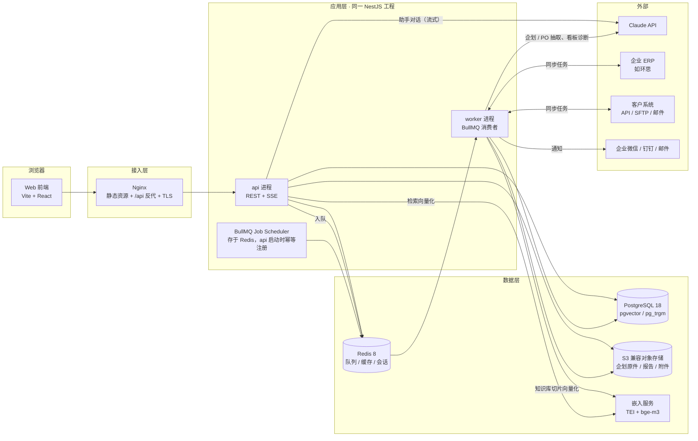
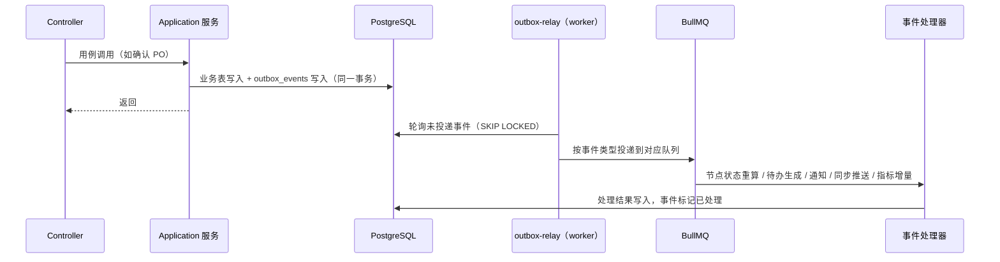
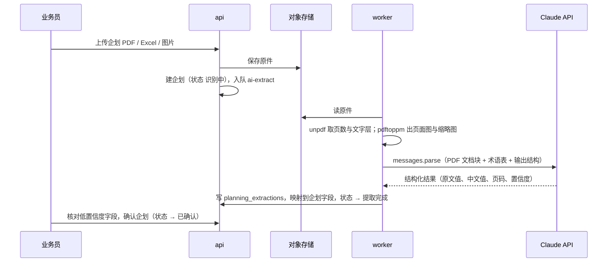
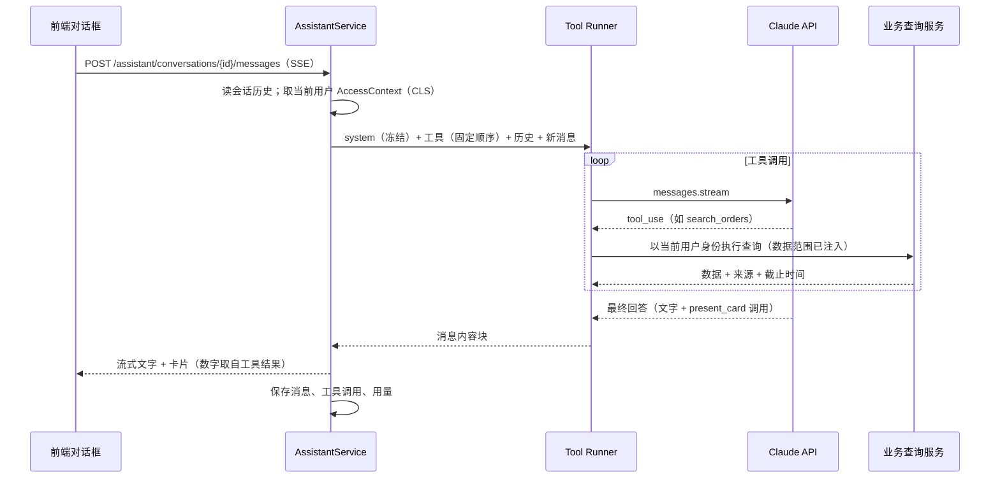

# OTD 订单交付平台 · 技术方案

> 版本 v1.0 · 2026-11-15
>
> 输入：[README 全局统一约定](./README.md)、[00-视频解析](./00-视频解析.md)、[01-需求文档](./01-需求文档.md)、[02-业务设计](./02-业务设计.md)、[03-界面设计](./03-界面设计.md)
>
> 选型前提：项目主要由 AI 编程工具（Claude Code、Codex）开发，人负责需求、审查和验收。选型标准是「AI 写得最好、人审得最快、出错最容易被发现」，同时满足企业级系统对权限隔离、审计、集成和长期维护的要求。
>
> 本文的库版本均于 2026-11-15 用 `npm view` 实查；前端版本以 `~/WebstormProjects/frontend-react-template/package.json` 锁定值为准。

## 1. 选型及理由

### 1.1 结论

| 层 | 选型 |
| --- | --- |
| 语言 | TypeScript，前后端统一 |
| 仓库 | 一个 pnpm monorepo（pnpm workspaces + Turborepo），依赖版本统一放 `pnpm-workspace.yaml` 的 catalog |
| 前端 | 沿用 `frontend-react-template`：Vite + React 19 + TypeScript strict + shadcn/ui + Tailwind CSS v4 + React Router（模板为 v8 Data Mode）+ TanStack Query / Table + React Hook Form + Zod + i18next + Zustand（仅 UI 偏好）+ MSW |
| 后端 | NestJS 12（模块化单体），运行在 Node.js 22 LTS |
| ORM | **Drizzle ORM**（理由见 1.3） |
| 数据库 | PostgreSQL 18，扩展 `pgvector`（知识库向量）、`pg_trgm`（全局模糊搜索） |
| 缓存 / 队列 | Redis 8 + BullMQ（异步任务、定时巡检、同步任务、AI 任务、通知） |
| 事务与上下文 | `nestjs-cls` + `@nestjs-cls/transactional`（Drizzle 适配器），一个用例一个事务 |
| 接口契约 | Zod 4 定义在 `packages/contracts`，前后端共用；后端由同一份定义生成 OpenAPI 文档供外部系统对接 |
| 对象存储 | S3 兼容协议，代码只依赖 `@aws-sdk/client-s3`；私有化默认 SeaweedFS，上云用阿里云 OSS / AWS S3 |
| 搜索 | 一期不引入 Elasticsearch：单号 / 款号 / 客户的全局搜索用 PostgreSQL `pg_trgm` + GIN 索引，知识库用 `pgvector` + 关键词混合检索 |
| 图表 | Recharts（模板已带，shadcn `chart` 组件基于它） |
| 文档解析 | 语义抽取交给 Claude（PDF 原生输入）；本地用 `unpdf` 读文字层和页数、`poppler-utils`（`pdftoppm`）出页面图片、`sharp` 生成缩略图、`exceljs` 读写 Excel |
| AI | Claude API，官方 SDK `@anthropic-ai/sdk`，默认模型 `claude-opus-5-5`（见第 9 节） |
| 嵌入模型 | 私有部署 `bge-m3`（Hugging Face Text Embeddings Inference 容器），知识库原文不外发 |
| 日志 / 监控 | pino（`nestjs-pino`）+ OpenTelemetry + Prometheus 指标 + Sentry（前后端） |
| 测试 | Vitest（全仓）、Testcontainers（PostgreSQL / Redis 集成测试）、Playwright（E2E） |

一句话理由：前后端同一种语言、同一个仓库、共享状态名和接口契约，AI 一次改动就能把契约、后端、前端一起改对；NestJS 的模块与依赖注入正好对应本系统 22 个业务模块加 10 余个平台模块的规模，边界清楚，适合多人和 AI 并行开发。

### 1.2 后端框架

| 方案 | 结论 |
| --- | --- |
| **NestJS（采用）** | 模块、依赖注入、守卫、拦截器、管道是现成的企业级骨架；权限守卫、审计拦截器、事务、队列消费者都有标准写法，AI 生成代码的一致性高；v12 原生 ESM |
| Hono | 轻量，LuckDay 在用；但本系统有 30 多个模块和大量横切关注点（权限、数据范围、审计、事务），自建分层规范的成本高于直接用 Nest |
| Java Spring Boot | 国内企业项目常见，但前后端两种语言，契约不能共享，AI 跨端修改容易不一致 |

注意：`nestjs-zod` 5.6.0 的 peer 依赖只到 `@nestjs/common` 11，尚未声明支持 Nest 12。本项目不依赖它，自写约 50 行的 `ZodValidationPipe` 和一个把 Zod 定义注册进 OpenAPI 的小工具（Zod 4 自带 `z.toJSONSchema()`）。

### 1.3 ORM：采用 Drizzle

| 考察点 | Drizzle | Prisma |
| --- | --- | --- |
| 数据范围注入（本系统最关键） | 查询就是 SQL 构建器，`where(and(条件, scoped(table)))` 直接拼接，联表、子查询、聚合里都能注入，行为可预期 | 要靠 Client Extension 拦截 `$allOperations` 改写 `where`，嵌套关系查询和 `$queryRaw` 都会绕过，容易漏 |
| 复杂报表 SQL（看板、产能台账、巡检） | 原生支持 CTE、窗口函数、`sql` 模板，类型跟随 | 需要 `$queryRaw` 或 TypedSQL，类型和数据范围都要另外处理 |
| 迁移 | `drizzle-kit generate` 生成 SQL 文件入库，评审直观 | `prisma migrate` 成熟 |
| 与事务上下文集成 | 有 `@nestjs-cls/transactional-adapter-drizzle-orm` | 也有适配器 |
| 版本状态 | 稳定版 0.45.4，1.0 处于 RC（1.0.0-rc.5） | `@prisma/client` 稳定版 7.10.1；`prisma` CLI 的 latest 标签目前指向 8.0.0-rc.33，升级节奏需要盯 |
| 团队已有经验 | LuckDay 在用 | 用过 |

结论：选 Drizzle 0.45.x，锁定版本；1.0 正式发布后单独评估升级。数据范围以应用层统一注入为主（第 11 节），PostgreSQL 行级安全（RLS）作为 P2 的加固项评估。

### 1.4 主要依赖版本（2026-11-15 实查）

| 包 | 版本 | 用途 |
| --- | --- | --- |
| react / react-dom | 19.2.7 | 模板锁定 |
| vite | 8.1.3 | 模板锁定 |
| typescript | 6.0.3 | 模板锁定，全仓统一 |
| react-router | 8.1.0 | 模板锁定（npm 最新 8.5.1，随模板升级） |
| @tanstack/react-query | 5.101.2 | 模板锁定 |
| @tanstack/react-table | 8.21.3 | 模板锁定 |
| @tanstack/react-virtual | 3.14.26 | 大表格虚拟滚动（新增） |
| zod | 4.4.3（模板）/ 4.6.7（最新） | 全仓统一到 catalog 一个版本 |
| i18next / react-i18next | 26.3.4 / 17.0.8 | 模板锁定 |
| recharts | 2.15.4 | 模板锁定 |
| tailwindcss | 4.3.2 | 模板锁定 |
| msw | 2.14.6 | 模板锁定 |
| @nestjs/core / common / testing | 12.5.0 | 后端框架 |
| @nestjs/platform-fastify | 12.5.0 | HTTP 适配器（Fastify，性能和 SSE 更好） |
| @nestjs/swagger | 12.1.2 | OpenAPI |
| @nestjs/bullmq | 12.0.2 | 队列 |
| @nestjs/config / terminus / throttler | 12.1.1 / 12.1.0 / 6.7.1 | 配置、健康检查、限流 |
| nestjs-cls / @nestjs-cls/transactional | 7.0.2 / 4.0.2 | 请求上下文、事务 |
| @nestjs-cls/transactional-adapter-drizzle-orm | 2.0.2 | Drizzle 事务适配 |
| drizzle-orm / drizzle-kit | 0.45.4 / 0.31.11 | ORM、迁移 |
| pg / pgvector | 8.23.1 / 0.3.1 | 驱动、向量类型 |
| bullmq / ioredis | 6.7.6 / 6.0.0 | 队列、Redis |
| @anthropic-ai/sdk | 1.8.0 | Claude API |
| @aws-sdk/client-s3 | 3.1169.0 | 对象存储 |
| unpdf / exceljs / sharp | 2.2.0 / 4.4.0 / 0.35.5 | PDF 文字层、Excel、图片 |
| @node-rs/argon2 | 2.2.2 | 密码哈希 |
| nestjs-pino / pino | 5.3.1 / 10.4.0 | 日志 |
| @sentry/nestjs / @sentry/react | 11.12.0 | 错误监控 |
| @opentelemetry/sdk-node | 0.301.2 | 链路追踪 |
| testcontainers / @testcontainers/postgresql | 12.2.1 | 集成测试 |
| vitest / @playwright/test | 4.1.10 / 1.61.1 | 测试 |
| unplugin-swc | 2.0.0 | Vitest 下编译 Nest 装饰器 |

## 2. 系统架构

### 2.1 总体架构



### 2.2 进程职责

| 进程 | 职责 | 扩容方式 |
| --- | --- | --- |
| api | 全部 REST 接口、SSE（通知角标、助手流式回答、单据变更推送）、权限与审计、写 outbox | 无状态，水平扩容 |
| worker | 消费 BullMQ 队列：`ai-extract`、`ai-diagnose`、`inspection`、`sync`、`outbox-relay`、`notify`、`export`、`kb-index`、`metrics` | 按队列分组部署，按队列深度扩容 |
| Job Scheduler | 不是常驻进程：巡检、同步、看板快照、台账提醒等周期任务用 BullMQ `upsertJobScheduler` 注册在 Redis 里，api 启动时幂等写入，由 worker 执行 | — |

### 2.3 为什么是模块化单体

1. 单企业私有化部署（README 关键决策），用户规模在数百人量级，单体完全够用。
2. 主线 10 节点之间强关联：确认 PO 要读企划、报价、测试，验货放行要读测试报告和包装方案；放在一个数据库里用事务保证一致，比跨服务的最终一致简单得多。
3. 团队小、主要由 AI 开发：一个工程、一套类型，改动面可控。
4. 边界靠 Nest 模块和 lint 规则保证（模块只能通过对方导出的 service 访问，不能直接查对方的表），将来真要拆服务，按模块边界拆即可。
5. api 和 worker 用同一份代码、不同入口，部署成两类容器，已经获得了「请求处理」和「后台任务」隔离的主要好处。

## 3. 仓库结构

```text
OTD-Platform/
├─ apps/
│  ├─ web/                 前端，直接由 frontend-react-template 复制而来（保留其分层和工程化命令）
│  └─ api/                 NestJS 工程：src/main.ts（api 入口）、src/worker.ts（worker 入口）
├─ packages/
│  ├─ shared/              全局约定落成的代码：模块编号、节点编号、单号前缀与格式化、状态枚举、角色编码、权限码、菜单树、季节编码
│  ├─ contracts/           Zod 接口契约（按模块分文件）、错误码枚举、分页 / 筛选通用结构
│  ├─ db/                  Drizzle 表结构、迁移 SQL、种子数据、测试库工具
│  ├─ flow-engine/         纯函数：主线节点状态推导、闸门校验、单据状态机、时效计算
│  ├─ rules/               纯函数：巡检规则定义与判定、PO 复核规则包、报价护栏校验
│  ├─ sync-mapping/        纯函数：字段映射与转换 DSL 的解析和执行
│  ├─ ai-schemas/          AI 抽取与诊断的 Zod 输出结构、提示词模板、回答卡片协议
│  ├─ ui-tokens/           7 套主题令牌（tokens.ts）与生成的 CSS
│  └─ config/              TypeScript、ESLint、Prettier 共享配置
├─ 产品文档/               需求、设计、技术文档（AI 开发的事实来源）
├─ deploy/                 docker compose、Nginx 配置、Helm chart（P3）
├─ AGENTS.md               给 AI 的全局约定（Claude Code 与 Codex 共用），CLAUDE.md 只写 @AGENTS.md
└─ .github/workflows/      CI（远端仓库确定后调整）
```

说明：

- api 和 worker 是同一个 Nest 工程的两个入口，而不是 `apps/api` + `apps/worker` 两个工程，避免业务模块代码在两处重复或再抽一层包；部署时同一个镜像用不同启动命令。
- `packages/flow-engine`、`rules`、`sync-mapping` 是不依赖数据库和网络的纯 TypeScript 包，方便写大量表驱动测试，也方便 AI 单独修改和验证。
- README「全局统一约定」A–F 节在 `packages/shared` 里是唯一实现：

| README 约定 | 代码位置 | 形式 |
| --- | --- | --- |
| A 模块编号 | `shared/src/modules.ts` | `MODULES` 常量（编号、key、i18n key、权限码前缀） |
| B 主线节点 | `shared/src/mainline.ts` | `NODES`（N01–N10、闸门 G1 / G2）、`NodeState` 枚举 |
| C 单号规则 | `shared/src/doc-no.ts` | `DOC_PREFIX` 表 + `formatDocNo(prefix, date, seq)` + `parseDocNo()` |
| D 单据状态 | `shared/src/status/*.ts` | 每类单据一个 `as const` 数组 + 合法流转表，前端标签用 i18n key `status:<单据>.<状态>` |
| E 角色 | `shared/src/roles.ts` | 预置角色编码、类型、默认数据范围（种子数据由此生成） |
| F 术语 | `shared/src/glossary.ts` | 术语中英对照，供界面、AI 抽取提示词、翻译共用 |

改约定的顺序：先改 README，再改 `packages/shared`，类型检查会把所有受影响的地方报出来。

## 4. 后端分层与模块

### 4.1 分层

```text
controller     HTTP 入口：路由、Zod 校验管道、@Permission 声明、响应封装；不写业务
application    用例服务：一个公开方法 = 一个用例 = 一个事务；调用 domain 校验，调用 repository 读写，写 outbox 事件
domain         纯业务规则：直接调用 packages/flow-engine、packages/rules；不依赖 Nest 和数据库
repository     Drizzle 读写：所有查询经过 scoped() 注入数据范围；只被本模块的 application 使用
```

依赖方向：controller → application → domain / repository；模块之间只能调用对方 `exports` 的 application 服务或只读查询服务，不能 import 对方的 repository 或表定义（ESLint `no-restricted-imports` 强制）。

### 4.2 模块划分

| 编号 | Nest 模块 | 主要职责 |
| --- | --- | --- |
| M00 | `TodoModule` | 待办生成、分组（已逾期 / 今日到期 / 后续）、今日重点关注聚合 |
| M01 | `AssistantModule` | 会话、工具调用、回答卡片、知识检索（第 9 节） |
| M02 | `PlanningModule` | 企划、原件、AI 抽取结果、确认、归档 |
| M03 | `SampleModule` | 样品库、打样单与轮次、阶段日志、备料登记 |
| M04 | `QuoteModule` | 成本核算、报价策略、报价轮次、护栏校验 |
| M05 | `SampleShipmentModule` | 寄样列表、收件人管理、留样分配 |
| M06 | `TestingModule` | 送测单、测试报告、有效期、复用核验 |
| M07 | `PackagingModule` | 包装方案（版本）、装箱单 |
| M08 | `CapacityModule` | 产能台账（版本）、台账更新任务 |
| M09 | `OrderModule` | 客户订单、PO 版本、工厂回复、订单阶段、订单监控 |
| M10 | `InspectionModule` | 验货单、轮次、缺陷、放行（G2） |
| M11 | `ShipmentModule` | 订舱、出货、物流节点 |
| M12 | `ReceivableModule` | 开票、应收、收款核销、催收记录 |
| M13 | `PurchaseModule` | 采购单、到货登记 |
| M14 | `FactoryAuditModule` | 验厂计划、记录、整改 |
| M15 | `DocumentModule` | 技术资料包、开发移交（G1）、知识库文档 |
| M16 | `PatrolModule` | 巡检规则、巡检任务、命中（第 8 节） |
| M17 | `MetricsModule` | 指标口径、看板快照、智能诊断 |
| M18 | `SyncModule` | 对端系统、字段映射、同步任务、重试队列（第 10 节） |
| M19 | `FlowConfigModule` | 服务目录、客户流程配置、规则包、配置发布与快照 |
| M20 | `MasterDataModule` | 客户、工厂与基地、针型、物料、检测机构、货代船司、字典、汇率 |
| M21 | `IamModule` | 用户、角色、组织、权限、个人偏好 |
| 平台 | `AuthModule` | 登录、令牌、刷新、会话吊销 |
| 平台 | `MainlineModule` | 节点状态快照维护、订单监控查询（第 7 节） |
| 平台 | `AuditModule` | 操作日志、关键变更快照、回退（第 12 节） |
| 平台 | `NumberingModule` | 单号发号 |
| 平台 | `FileModule` | 上传、预签名下载、缩略图 |
| 平台 | `NotificationModule` | 站内通知、SSE、外部渠道 |
| 平台 | `OutboxModule` | 领域事件落库与投递 |

### 4.3 事务边界

- 一个 application 方法一个事务，用 `@Transactional()`（`@nestjs-cls/transactional`）声明；repository 通过 `TransactionHost` 拿当前事务，不自己开事务。
- 事务内只做数据库读写；调用外部系统（Claude、ERP、对象存储上传之外的操作）一律放到事务提交之后的异步任务里。
- 跨模块的「顺带更新」（如订单确认后要生成待办、刷新节点状态、推送客户系统）不在同一事务里直接调用，而是写 outbox 事件，由 worker 异步处理。必须同事务完成的（如出货签收同时生成应收单）在用例里显式调用对方 application 服务。

### 4.4 领域事件与 outbox



- 事件命名 `<模块>.<对象>.<动作>`，如 `planning.planning.confirmed`、`sample.round.approved`、`testing.report.archived`、`quote.round.accepted`、`document.handover.completed`、`order.order.confirmed`、`inspection.inspection.released`、`shipment.shipment.signed`、`receivable.receivable.overdue`。
- 事件载荷只放标识和必要的前后状态，处理器自己回查最新数据；处理器必须幂等（按 `event_id` 去重）。
- outbox 投递保证「至少一次」，处理器幂等保证「效果恰好一次」。

## 5. 数据模型

### 5.1 通用字段与约定

| 约定 | 说明 |
| --- | --- |
| 主键 | `id uuid`（UUID v7，按时间有序，利于索引）；对外展示用业务单号 `doc_no`，唯一索引 |
| 审计字段 | `created_at`、`created_by`、`updated_at`、`updated_by`，全部业务表必带 |
| 乐观锁 | `version integer`，每次更新 +1，接口带 `If-Match` 或请求体 `version`（第 6.5 节） |
| 数据归属 | 业务单据必带 `owner_id`（负责人，通常是业务员）、`org_id`（所属组织）、`customer_id`（所属客户）；数据范围注入只认这三个字段（第 11 节） |
| 软删除 | 只用于主数据（客户、工厂、物料等）：`deleted_at`；业务单据不删除，用「已取消 / 已归档」状态 |
| 时间 | 时间点用 `timestamptz`；业务日期（交期、到期日、ETD）用 `date`；时区按用户请求头 `X-TimeZone` 展示 |
| 金额 | `numeric(18,4)` + `currency char(3)`（ISO 4217）；报价单价保留 4 位，汇总金额展示 2 位；汇率存 `exchange_rates` 表，报价的锁汇值存在报价轮次上 |
| 数量 | 双数用 `integer`；重量 / 体积用 `numeric(12,3)` |
| 状态 | `text` 列 + CHECK 约束，取值来自 `packages/shared` 的状态枚举；流转合法性在 domain 层校验 |
| 版本表 | 需要「当前执行哪一版、谁改了什么」的对象建版本表：`po_revisions`、`packaging_plan_versions`、`quote_rounds`、`capacity_ledger_versions`、`customer_flow_versions`、`sync_mapping_versions` |

### 5.2 JSONB 的使用边界

只在以下场景用 JSONB：

1. 客户差异化的属性：企划的 Tech Pack 产品属性（不同客户字段不同）`plannings.product_attrs`。
2. AI 原始结果：`planning_extractions.raw_output`、`ai_messages.content`（原样保存模型返回的内容块）。
3. 配置与规则参数：巡检规则参数、规则包参数、字段映射定义、流程配置快照。
4. 审计前后值：`audit_logs.diff`、`change_snapshots.snapshot`。

凡是要用来筛选、关联、统计的字段（客户、款号、数量、金额、交期、状态、负责人）一律建成普通列。确需按 JSONB 内字段查询时建表达式索引，并在评审中说明理由。

### 5.3 主要表

| 分组 | 表 | 关键字段 |
| --- | --- | --- |
| 组织权限 | `orgs` | `code`（ORG001）、`name`、`type`、`parent_id`、`path`（物化路径 `/1/3/7/`）、`leader_id`、`status` |
| | `users` | `phone`、`email`、`name`、`password_hash`、`primary_org_id`、`status`、`locale`、`preferences jsonb` |
| | `roles` / `user_roles` | `code`（R001）、`type`（业务角色 / 管理角色）、`data_scope`、`customer_scope_mode` |
| | `role_permissions` / `role_customers` / `role_orgs` | 角色 × 权限码、角色 × 客户、自定义数据范围的组织 |
| | `refresh_tokens` | `user_id`、`token_hash`、`expires_at`、`revoked_at`、`device` |
| 主数据 | `customers` | `code`（简码 BBS）、`name`、`settlement_entity`、`payment_terms_days`、`ai_allowed`（是否允许发给 AI）、`owner_org_id` |
| | `bases` / `factories` | 基地、工厂、工厂主体 |
| | `needle_types` / `base_machines` | 针型（96N…）、基地 × 针型 × 开机台数 |
| | `materials`、`test_agencies`、`forwarders`、`carriers`、`dictionaries`、`exchange_rates`、`seasons` | |
| 流程配置 | `service_modules` / `service_items` | 全局服务目录（视频 15 个模块） |
| | `customer_flows` / `customer_flow_versions` | 客户流程、已发布版本（不可变） |
| | `customer_flow_modules` / `customer_flow_items` | 版本下启用的模块（排序、负责部门）与服务项（参数） |
| | `rule_packs` | PO 复核、放行等规则包，按客户覆盖 |
| 开发阶段 | `styles` | 客户 + 款号唯一；名称（中 / 英）、品类、季节；开发阶段对象都挂在款上 |
| | `plannings` / `planning_files` / `planning_extractions` | 企划（BR）、原件、AI 抽取结果与置信度 |
| | `samples` / `sample_rounds` / `sample_stage_logs` | 打样单（SP）、轮次（PROTO 第 N 轮）、阶段日志（含实际用时） |
| | `sample_shipments` | 寄样单（SM） |
| | `test_requests` / `test_reports` / `test_report_links` | 送测单（TST）、报告（机构报告号、有效期）、报告与款 / 工艺的复用关系 |
| | `quote_strategies` / `quotes` / `quote_rounds` / `quote_cost_items` | 策略（PS）、报价单（QT）、轮次（内部 / 客户）、成本明细 |
| | `handover_packages` | 开发移交包（DH）、五项齐套快照、冻结时间 |
| 订单阶段 | `customer_orders` | 客户 PO 号、当前 PO 版本、客户、季节、贸易术语、币种、FOB 金额、客户交期、工厂交期回复、承做工厂、状态、`flow_version_id` |
| | `order_lines` | 款 × 颜色 × 尺码 × 数量、单价 |
| | `po_revisions` / `factory_replies` / `order_stage_logs` | PO 版本（Rev.N）、工厂交期回复（V1…）、阶段流转 |
| | `packaging_plans` / `packaging_plan_versions` / `cartons` | 包装方案（PK，当前版本指针）、版本、装箱单（CT） |
| | `purchase_orders` / `purchase_lines` / `purchase_receipts` | 采购单（PUR）、明细、到货 |
| | `capacity_ledger_versions` / `capacity_rows` / `ledger_update_tasks` | 台账版本（V26）、基地 × 针型行、更新任务 |
| | `production_progress` | 订单 × 工厂的生产进度登记（一期不做 MES） |
| | `inspections` / `inspection_defects` | 验货单（INSP）、阶段（IPI / DPI / FRI）、轮次、结论、缺陷 |
| | `bookings` / `shipments` / `shipment_events` | 订舱（BK）、出货（SH）、物流节点 |
| | `invoices` / `receivables` / `receipts` / `receipt_allocations` / `collection_logs` | 发票、应收（AR）、收款、核销、催收记录 |
| | `factory_audits` / `audit_findings` | 验厂（AUD）、整改项 |
| 平台 | `node_state_snapshots` | 订单 × 节点的推导状态（第 7 节） |
| | `todos` | 来源（流程 / 巡检 / 手工 / AI 草稿）、关联单据、指派人、截止时间、状态 |
| | `patrol_rules` / `patrol_runs` / `patrol_hits` | 巡检规则（IR）、巡检任务（PT）、命中 |
| | `metric_snapshots` / `diagnoses` | 看板指标日快照、智能诊断结论 |
| | `sync_endpoints` / `sync_mappings` / `sync_tasks` / `sync_runs` / `sync_batches` / `sync_records` / `sync_links` | 对端、映射、任务（SYN）、执行、批次、记录（失败与重试）、本地与对端标识对照 |
| | `ai_conversations` / `ai_messages` / `ai_tool_calls` / `ai_usage` | 会话、消息、工具调用（含结果数据）、用量与成本 |
| | `kb_documents` / `kb_chunks` | 知识库文档、切片（`embedding vector(1024)`、HNSW 索引） |
| | `audit_logs` / `change_snapshots` | 操作日志（按月分区）、关键变更快照 |
| | `outbox_events`、`number_sequences`、`files`、`notifications` | |

### 5.4 表结构示例

```ts
export const auditColumns = {
  createdAt: timestamp("created_at", { withTimezone: true }).notNull().defaultNow(),
  createdBy: uuid("created_by").notNull(),
  updatedAt: timestamp("updated_at", { withTimezone: true }).notNull().defaultNow(),
  updatedBy: uuid("updated_by").notNull(),
  version: integer("version").notNull().default(1),
};

export const ownershipColumns = {
  ownerId: uuid("owner_id").notNull(),
  orgId: uuid("org_id").notNull(),
  customerId: uuid("customer_id").notNull(),
};

export const customerOrders = pgTable(
  "customer_orders",
  {
    id: uuid("id").primaryKey(),
    poNo: text("po_no").notNull(),
    currentRevision: integer("current_revision").notNull().default(1),
    seasonCode: text("season_code").notNull(),
    tradeTerm: text("trade_term"),
    currency: char("currency", { length: 3 }).notNull(),
    fobAmount: numeric("fob_amount", { precision: 18, scale: 4 }),
    totalPairs: integer("total_pairs").notNull(),
    customerDueDate: date("customer_due_date").notNull(),
    factoryReplyDate: date("factory_reply_date"),
    factoryId: uuid("factory_id"),
    status: text("status").notNull(),
    flowVersionId: uuid("flow_version_id").notNull(),
    ...ownershipColumns,
    ...auditColumns,
  },
  (t) => [
    uniqueIndex("uq_customer_orders_customer_po").on(t.customerId, t.poNo),
    index("ix_customer_orders_scope").on(t.orgId, t.ownerId, t.customerId),
    index("ix_customer_orders_status_due").on(t.status, t.customerDueDate),
    index("ix_customer_orders_po_trgm").using("gin", sql`${t.poNo} gin_trgm_ops`),
  ],
);

export const nodeStateSnapshots = pgTable(
  "node_state_snapshots",
  {
    orderId: uuid("order_id").notNull(),
    nodeCode: text("node_code").notNull(),
    state: text("state").notNull(),
    enteredAt: timestamp("entered_at", { withTimezone: true }),
    completedAt: timestamp("completed_at", { withTimezone: true }),
    assigneeId: uuid("assignee_id"),
    blockedReasons: jsonb("blocked_reasons").$type<string[]>(),
    summary: text("summary"),
    computedAt: timestamp("computed_at", { withTimezone: true }).notNull(),
  },
  (t) => [primaryKey({ columns: [t.orderId, t.nodeCode] }), index("ix_node_state").on(t.nodeCode, t.state)],
);
```

### 5.5 单号发号

`number_sequences(prefix, period, current_value)`，发号在业务事务内执行 `INSERT … ON CONFLICT DO UPDATE SET current_value = current_value + 1 RETURNING current_value`，再用 `packages/shared` 的 `formatDocNo` 按 README C 节格式化。流水号可能因事务回滚出现空号，业务上允许，不做补号。客户侧编号（款号、客户 PO、机构报告号）原样保存，不经过发号。

## 6. 接口约定与错误码

### 6.1 基本风格

- 前缀 `/api/v1`；资源用复数名词：`/orders`、`/orders/{id}`、`/orders/{id}/revisions`。
- 状态流转是动作接口：`POST /orders/{id}/confirm`、`POST /inspections/{id}/release`、`POST /plannings/{id}/archive`；不允许用 `PATCH status` 直接改状态。
- 字段命名 camelCase；日期 `YYYY-MM-DD`，时间 ISO 8601 带时区；金额用字符串传输（避免浮点误差）并附带 `currency`。
- 请求和响应结构只在 `packages/contracts` 定义，后端用它校验，前端用它推导类型。

### 6.2 响应信封

沿用前端模板默认的 `bipo` 信封适配器，前端 HTTP 层不用改：

```ts
type Envelope<T> = {
  errcode: 0 | string;
  errmsg?: string;
  errParams?: Record<string, unknown>;
  data?: T;
  requestId: string;
};
```

成功 `errcode: 0`；失败时 HTTP 状态码照常返回（400 / 401 / 403 / 404 / 409 / 422 / 429 / 500），响应体仍是信封，模板拦截器会把它转成 `BizError`。`requestId` 等于请求头 `X-Trace-Id`（模板自动带），日志和链路追踪用它串起来。

### 6.3 分页、筛选、排序

```text
GET /api/v1/orders?page=1&pageSize=20&sort=-customerDueDate,poNo&status=PENDING_CONFIRM,SCHEDULING&customerId=…&keyword=10459
```

- 分页：`page` 从 1 开始，`pageSize` 默认 20、最大 200；响应 `data = { items, total, page, pageSize }`。
- 排序：`sort` 逗号分隔，`-` 表示降序，可排序字段在契约里白名单声明。
- 筛选：每个列表在契约里声明筛选字段；多值用逗号；日期区间 `dueFrom` / `dueTo`。
- 导出：`POST /orders/export` 用同样的筛选条件，异步生成 Excel，完成后通知下载。

### 6.4 幂等

创建类和外部回调接口支持 `Idempotency-Key` 请求头：Redis 记录 24 小时，同 key 重复请求直接返回首次结果。前端在提交表单时生成 key，防止重复点击；对外的 webhook 用对方的事件 ID 作为 key。

### 6.5 并发控制

更新和动作接口必须带 `version`（请求体字段，或 `If-Match` 头）；SQL `UPDATE … WHERE id = $1 AND version = $2`，影响 0 行返回 409 `COMMON_VERSION_CONFLICT`，前端提示「数据已被他人修改」并刷新。

### 6.6 错误码

格式 `<模块>_<含义>`，大写下划线，全部登记在 `packages/contracts/src/errors.ts`，新增先改本节。

| 错误码 | HTTP | 含义 |
| --- | --- | --- |
| `COMMON_VALIDATION_FAILED` | 422 | 请求参数校验失败，`errParams.fields` 给出字段与原因 |
| `COMMON_NOT_FOUND` | 404 | 对象不存在或不在当前用户数据范围内（两者不区分，避免探测） |
| `COMMON_VERSION_CONFLICT` | 409 | 乐观锁冲突 |
| `COMMON_IDEMPOTENCY_REPLAY` | 409 | 同一幂等键的请求仍在处理中 |
| `COMMON_RATE_LIMITED` | 429 | 触发限流 |
| `AUTH_INVALID_CREDENTIALS` | 401 | 账号或密码错误 |
| `AUTH_ACCOUNT_LOCKED` | 423 | 连续失败被锁定，`errParams.unlockAt` |
| `AUTH_TOKEN_EXPIRED` | 401 | 访问令牌过期（模板会自动刷新） |
| `IAM_FORBIDDEN` | 403 | 无此功能权限，`errParams.permission` |
| `FLOW_ILLEGAL_TRANSITION` | 409 | 单据状态不允许此动作，`errParams.from` / `action` |
| `FLOW_GATE_BLOCKED` | 409 | 闸门条件不满足，`errParams.gate`（G1 / G2）、`missing`（缺项列表） |
| `FLOW_NODE_NOT_APPLICABLE` | 409 | 该客户流程未启用此节点 |
| `PLANNING_EXTRACTION_PENDING` | 409 | 企划仍在识别中，不能确认 |
| `QUOTE_GUARDRAIL_VIOLATED` | 422 | 毛利低于护栏或价格超出设定，`errParams.margin` / `guardrail` |
| `ORDER_RULE_PACK_FAILED` | 422 | PO 复核规则包未全绿，`errParams.failedRules` |
| `TESTING_REPORT_EXPIRED` | 409 | 引用的测试报告已过期 |
| `PACKAGING_VERSION_LOCKED` | 409 | 已确认版本不可修改，需新建版本 |
| `SYNC_ENDPOINT_UNREACHABLE` | 502 | 对端系统不可达（同步接口手动触发时） |
| `AI_QUOTA_EXCEEDED` | 429 | 当日 AI 额度用尽 |
| `AI_CUSTOMER_NOT_ALLOWED` | 403 | 该客户数据不允许发送给 AI |
| `AI_UPSTREAM_FAILED` | 502 | 模型服务调用失败（已按策略重试） |

前端按 `errors:biz.<错误码>` 取多语言文案，用 `errParams` 插值；`errmsg` 由后端按 `X-LANGUAGE` 生成，供日志和外部调用方阅读。

### 6.7 OpenAPI

内部前端直接 import `packages/contracts` 的类型，不走代码生成。对外（客户系统、ERP 回调）的接口由同一份 Zod 定义生成 OpenAPI 3.1 文档，`/api/docs` 只在非生产环境开放，生产环境导出静态文件给对接方。

## 7. 流程与节点引擎

业务规则见业务设计第 2、3、4 节，本节只写实现。

### 7.1 原则

- 节点状态是**推导值**：由相关单据的状态推出，不允许人工改节点状态；要改就改单据。
- 推导逻辑是 `packages/flow-engine` 里的纯函数，输入是事实快照和流程配置，输出是 10 个节点的状态，便于表驱动测试。
- 推导结果写入 `node_state_snapshots`，供订单监控、列表筛选、巡检、看板直接查询，不在每次请求时现算。

```ts
type OrderFacts = {
  orderId: string;
  planning: { status: PlanningStatus; confirmedAt?: string } | null;
  sampleRounds: { status: SampleRoundStatus; stage?: SampleStage }[];
  testReports: { conclusion: "PASS" | "FAIL"; validUntil: string; applicable: boolean }[];
  quote: { latestRoundStatus: QuoteRoundStatus } | null;
  handover: { status: HandoverStatus; checklist: HandoverChecklist } | null;
  order: { status: OrderStatus; ruleCheck: RuleCheckResult };
  packaging: { status: PackagingStatus } | null;
  purchases: { status: PurchaseStatus }[];
  production: { completedPairs: number; totalPairs: number } | null;
  inspections: { stage: InspectionStage; conclusion?: "PASS" | "FAIL"; released: boolean }[];
  shipments: { status: ShipmentStatus }[];
  receivables: { status: ReceivableStatus; overdue: boolean }[];
  openRedHits: { nodeCode: NodeCode; ruleCode: string }[];
};

type NodeStateResult = {
  nodeCode: NodeCode;
  state: "PENDING" | "IN_PROGRESS" | "DONE" | "BLOCKED" | "NOT_APPLICABLE";
  blockedReasons: string[];
  summary: string;
};

declare function deriveNodeStates(facts: OrderFacts, flow: FlowRuntimeConfig, now: Date): NodeStateResult[];
declare function checkGate(gate: "G1" | "G2", facts: OrderFacts, flow: FlowRuntimeConfig): { passed: boolean; missing: string[] };
```

### 7.2 重算触发

1. 影响节点的领域事件（第 4.4 节）进入 `mainline-recompute` 队列，按订单 ID 作为 jobId 去重合并，500 毫秒防抖。
2. 开发阶段（N01–N05）的事件挂在款上：按 `styles` → 关联订单找到所有受影响订单，逐个重算；尚未有 PO 的款单独维护 `style_dev_states`（只含 N01–N05），供企划和打样列表展示。
3. 每天凌晨全量校准一次，防止事件丢失导致快照漂移，差异写日志告警。

### 7.3 闸门校验

闸门在**动作用例里强制校验**，而不只是展示：

| 闸门 | 触发动作 | 校验内容（README B 节） |
| --- | --- | --- |
| G1 开发移交 | `POST /handovers/{id}/complete` | 五项齐套；通过后写入齐套快照，开发资料（企划、样品、报价、测试）进入冻结，改动需走变更 |
| G2 验货放行 | `POST /inspections/{id}/release` | 三条件；不满足返回 `FLOW_GATE_BLOCKED` 与缺项；订舱可在放行前进行，出货批次推进到「装箱完成」及之后节点时二次校验 G2（业务设计 2.7） |

闸门所需条件可由客户流程配置裁剪（如某客户不要求 QRS），裁剪在配置发布时校验，不允许把闸门裁成空条件。

### 7.4 客户流程配置的运行时

- 配置编辑在草稿上进行，「发布」生成不可变的 `customer_flow_versions` 记录（含完整快照 JSONB 和摘要）。
- 绑定时机：款的开发对象在企划确认时绑定当时的发布版本；订单在 PO 确认时绑定 `flow_version_id`。之后客户改配置只影响新单，在途单据如需切换由管理员执行「迁移到新版本」并记审计。
- 运行时读取：`FlowRuntimeConfig` 按 `(customerId, versionId)` 缓存在进程内 LRU（上限 500）+ Redis，版本不可变所以无需失效；只有「客户当前版本指针」在发布时失效。
- 服务项的生效方式（业务设计第 4 节）：启用 / 停用节点、子步骤与必填单据、规则包参数、待办模板、巡检规则的客户范围。服务项在代码里是带 Zod 参数结构的注册表（`packages/shared/src/service-items.ts`），配置界面根据参数结构自动生成表单，因此「新增客户无需写代码」；新增一种服务项类型才需要开发。

### 7.5 时效与平均办结

阶段日志表记录每次进入 / 离开阶段的时间，「已耗时」实时计算；「平均办结」由夜间任务按（阶段 × 工厂 × 近 90 天）计算中位数和平均值写入 `stage_duration_stats`，详情页对比显示「慢于平均」。

## 8. 巡检调度与待办

业务规则见业务设计第 5、10 节。

### 8.1 规则实现方式

一期不做通用规则 DSL，而是「代码定义规则类型 + 数据库配置参数」：

```ts
type PatrolRuleDefinition<P> = {
  code: string;
  module: ModuleCode;
  targetType: string;
  paramsSchema: z.ZodType<P>;
  defaultParams: P;
  findCandidates: (db: ScopedDb, params: P, now: Date) => Promise<PatrolCandidate[]>;
  judge: (candidate: PatrolCandidate, params: P, now: Date) => PatrolJudgement | null;
};

type PatrolJudgement = {
  light: "RED" | "YELLOW";
  severity: "HIGH" | "MEDIUM" | "LOW";
  overdueDays: number;
  message: { key: string; params: Record<string, string | number> };
  assignee: { kind: "OWNER" } | { kind: "ROLE"; roleCode: string };
};
```

- `findCandidates` 是走索引的 SQL（如「打样轮次停留在已下达超过阈值」「客户批复等待超期」「采购逾期未到货」「送测超期未出报告」），`judge` 是纯函数，便于单元测试。
- `patrol_rules` 表存每条规则的启用状态、阈值参数、严重度、客户范围、执行频率；界面修改参数即生效，不需要发版。
- 规则类型放在 `packages/rules`，视频里的 18 条规则覆盖 8 个模块，一期按业务设计第 5 节的规则清单实现。条件组合类的需求积累到一定数量后再评估引入 DSL（如 JSON Logic）。

### 8.2 调度

| 任务 | 方式 | 频率 |
| --- | --- | --- |
| 自动巡检 | BullMQ Job Scheduler `patrol:auto` | 默认每天 00:50 全量一次，工作时间（08:00–20:00）每 2 小时一次，可在系统参数中配置（需求 F-M16-07） |
| 手动巡检（立即巡检） | 接口入队，优先级高；同一时刻只允许一个全量任务（固定 jobId） | 按需 |
| 单规则重跑 | 规则参数修改后自动入队该规则 | 按需 |

每次执行生成 `patrol_runs`（PT 单号）：触发方式、开始结束时间、耗时、各规则命中数、红 / 黄 / 绿统计。

### 8.3 去重与生命周期

- 命中键 = `(rule_code, target_type, target_id)`。已存在且未关闭的命中只更新 `last_seen_at`、灯色和逾期天数；本次没有再命中的自动关闭（`closed_reason = RESOLVED`）。
- 每个未关闭命中对应一条待办（`todos.source = PATROL`），指派人按 `assignee` 解析：对象负责人，或对象所属组织里指定角色的成员。
- 升级：红灯超过参数设定天数未处理，通知指派人的直属经理；升级动作写入命中历史。

### 8.4 待办与通知

- 待办来源：流程待办（领域事件按流程配置里的待办模板生成）、巡检待办、手工待办、AI 草稿待办（需用户确认才生效）。
- 今日待办页按截止时间分组；「今日重点关注」是固定的几个聚合查询（待确认订单、待船司确认订舱、待发货、逾期风险）。
- 通知：站内通知写 `notifications`，通过 SSE 推送角标；外部渠道（企业微信 / 钉钉 / 邮件）由 `notify` 队列发送，渠道适配器可插拔（P3）。

### 8.5 性能估算

按 5 万张在途单据、18 条规则估算：每条规则一条带索引的 SQL，单条 50–300 毫秒，全量一次约 2–5 秒（视频中 PT-0002 耗时 274 毫秒）。巡检只在 worker 执行，不占 api 资源；所有候选查询走只读连接池，必要时指向只读副本。

## 9. AI 实现

业务规则见业务设计第 8 节。本节按 `claude-api` 技能核对过的接口写法。

### 9.1 用途与调用位置

| 用途 | 调用位置 | 方式 | 模型与思考强度 |
| --- | --- | --- | --- |
| 企划原件抽取 + 翻译 | worker `ai-extract` 队列 | 单次调用 + 结构化输出 | `claude-opus-5-5`，`effort: "medium"` |
| PO 识别 | worker `ai-extract` 队列 | 单次调用 + 结构化输出 | `claude-opus-5-5`，`effort: "medium"` |
| 智能助手对话 | api，SSE 流式返回 | 工具调用循环（SDK Tool Runner） | `claude-opus-5-5`，简单问答 `low`，分析类 `medium` |
| 看板智能诊断 | worker `ai-diagnose` 队列 | 夜间 Message Batches；手动刷新用单次调用 | `claude-opus-5-5`，`effort: "high"` |

统一约定：

- SDK `@anthropic-ai/sdk` 1.8.0，客户端在 `AiGatewayService` 里单例创建，凭据从环境变量读取（`ANTHROPIC_API_KEY`），不进前端、不进数据库明文。
- Claude Opus 5.5 的思考不能关闭（`thinking` 省略即自适应，传 `disabled` 或 `budget_tokens` 会 400），用 `output_config.effort` 控制深度；该模型 `effort` 默认 `medium`，每个用途显式设置。
- 不使用助手消息预填（会 400）；不使用强制 `tool_choice`（`any` / `tool` 会 400），需要固定格式时用结构化输出或 `strict: true` 的工具。
- 长输入或长输出一律流式（`client.messages.stream()` + `finalMessage()`），避免 HTTP 超时。
- 拒答兜底：直连 Claude API 时启用服务端 fallback（`betas: ["server-side-fallback-2026-07-01"]`、`fallbacks: "default"`）；如果走 Amazon Bedrock / Google Vertex AI，改用 SDK 的客户端 `betaRefusalFallbackMiddleware`。读取内容前先检查 `stop_reason`（`refusal`、`max_tokens`）。
- 错误按 SDK 的类型化异常分级处理：`RateLimitError` / 5xx / 连接错误重试（SDK 默认重试 2 次，队列任务再按退避重试），400 / 404 不重试直接记失败。
- 每次调用记录 `ai_usage`：用途、用户、模型、输入 / 输出 / 缓存读写 token、估算成本、耗时、`stop_reason`、请求 ID。

### 9.2 企划原件与 PO 的抽取和翻译

流程：



实现要点：

- 输入：PDF 以 `document` 内容块传入（base64，单请求上限 32 MB、600 页），放在文本指令之前；同一份文件既要抽取又可能要重跑时，先用 Files API `client.files.upload` 上传，再以 `file_id` 引用。Excel 先用 `exceljs` 转成按工作表分段的文本表格；图片用 `image` 内容块。
- 输出：`client.messages.parse` + `zodOutputFormat(PlanningExtractionSchema)`，结构定义在 `packages/ai-schemas`。每个字段都带原文值、中文值、来源页码、证据原文和置信度，模型返回的是「候选值」，不直接写业务字段。
- 引用（citations）与结构化输出不能同时开启，因此来源页码和证据原文作为结构里的字段让模型填写，界面上点击可跳到原件对应页。
- 术语表：`packages/shared/src/glossary.ts` 和主数据字典里的客户专有术语（如 Cuff = 罗口、Toe Seam = 袜头缝）拼进 system，放在缓存断点之前。
- 置信度为 low 或必填字段缺失的，在企划详情里高亮，业务员必须逐项确认后才能「确认企划信息」。
- 识别失败（拒答、超时重试耗尽、结构解析失败）把企划置为「识别失败」，允许手工录入或重新识别。
- PO 识别同理：抽出客户 PO 号、版本、款 × 色 × 码 × 数量、单价、交期、贸易术语、付款条款、目的地等，随后交给 `packages/rules` 的 PO 复核规则包，与企划、报价、开发移交包逐项比对，得出「规则包校验全绿 / 红项列表」。

```ts
const ExtractedField = z.object({
  original: z.string().nullable(),
  zh: z.string().nullable(),
  page: z.number().int().nullable(),
  evidence: z.string().nullable(),
  confidence: z.enum(["high", "medium", "low"]),
});

export const PlanningExtractionSchema = z.object({
  styleNo: ExtractedField,
  nameEn: ExtractedField,
  nameZh: ExtractedField,
  category: ExtractedField,
  season: ExtractedField,
  sizeRange: ExtractedField,
  needleCount: ExtractedField,
  sockWeight: ExtractedField,
  requiredSampleDate: ExtractedField,
  productAttributes: z.array(z.object({ key: z.string(), labelEn: z.string(), labelZh: z.string(), value: ExtractedField })),
  images: z.array(z.object({ page: z.number().int(), description: z.string() })),
});

const response = await client.messages.parse({
  model: "claude-opus-5-5",
  max_tokens: 16000,
  output_config: { effort: "medium", format: zodOutputFormat(PlanningExtractionSchema) },
  system: [{ type: "text", text: extractionSystemPrompt, cache_control: { type: "ephemeral" } }],
  messages: [
    {
      role: "user",
      content: [
        { type: "document", source: { type: "file", file_id: uploaded.id } },
        { type: "text", text: buildExtractionInstruction(customer) },
      ],
    },
  ],
});
```

### 9.3 智能助手



权限上下文的强制方式：

- 工具的入参里**没有**用户、组织、客户范围这类字段，模型无法指定「以谁的身份查」。工具执行函数在服务端从 CLS 取当前用户的 `AccessContext`，调用的是与界面相同的 application 查询服务，数据范围由 repository 统一注入，和用户在界面上能看到的完全一致。
- 工具结果只返回该用途需要的字段，按「AI 外发字段白名单」裁剪；`customers.ai_allowed = false` 的客户，其数据在工具结果里替换为「该客户数据不参与 AI 分析」。
- 写操作不直接执行：「辅助处理业务任务」类工具（如生成催收记录草稿、建待办、起草客户邮件）只生成**草稿**并以确认卡片返回，用户在界面点确认后走正常接口和权限校验。

工具清单（首版）：`search_orders`、`get_order_progress`、`list_my_todos`、`get_receivable_summary`、`get_capacity_summary`、`get_inspection_status`、`get_metric`（指标口径里登记过的指标）、`search_knowledge`、`draft_collection_log`、`draft_todo`、`present_card`。工具用 `betaZodTool` 定义，`strict: true`；流式请求下开启 `eager_input_streaming: true`，并在执行前用 Zod 再校验一次入参，校验失败按无效输入返回 `is_error` 结果。

回答卡片协议（`packages/ai-schemas/src/cards.ts`）：

- 卡片类型：`kpi`（指标组）、`bar`（分布条形）、`line`（趋势折线）、`table`（明细）、`list`（单据列表）、`action`（待确认的草稿动作）。
- 模型通过 `present_card({ toolCallId, cardType, title })` 指定「把哪次工具调用的结果以什么卡片展示」，卡片里的数字由服务端按工具结果渲染，**不由模型生成**，保证数字准确。
- 每个工具结果都带 `source`（如「订单管理 · 客户订单」）和 `asOf`（数据截止时间），卡片底部展示；system 要求文字结论里引用的数字必须来自工具结果。

会话与上下文：

- `ai_messages.content` 原样保存模型返回的内容块（含 thinking 块），下一轮原样回传，不在中间删改历史（Opus 5.5 会校验历史编辑）。会话过长时提示用户新开会话；必要时评估服务端压缩（beta）。
- 当前用户身份、日期、数据范围描述放在会话第一条用户消息之前的上下文里（作为首条用户消息的前缀文本），不放进 system，保证 system 和工具定义可以跨用户命中缓存。

### 9.4 知识库检索

- 来源：资料管理（M15）里的客户手册、工艺标准、SOP、客户规则口径说明；上传后由 `kb-index` 队列切片（按标题层级，约 800 字一片，带重叠）。
- 向量化：私有部署的 `bge-m3`（1024 维），知识库原文不发给第三方；`kb_chunks.embedding` 建 HNSW 索引。Claude API 本身不提供嵌入接口。
- 检索：向量相似度 + `pg_trgm` 关键词混合打分，SQL 里同时按文档的客户 / 组织可见范围过滤；`search_knowledge` 工具返回片段原文、文档名、版本和链接，回答里引用文档名。

### 9.5 看板智能诊断

- 夜间 `metrics` 任务先用 SQL 算好各看板、各数据范围的指标快照（`metric_snapshots`），指标口径见业务设计第 9 节。
- `ai-diagnose` 把每个（看板 × 范围）的指标 JSON 作为输入，用 Message Batches 批量提交（异步、半价），结构化输出为「结论与建议」列表：`{ level: "优先处理" | "建议关注", title, evidence, suggestion, metricKeys[] }`。批量结果按 `custom_id` 回填，不依赖返回顺序。
- 数字校验：服务端提取结论里出现的数字，与 `metricKeys` 对应的指标值比对，对不上的结论丢弃并记日志。
- 用户点「刷新诊断」时对当前范围单独调用一次 `messages.parse`，结果缓存到下一次指标更新。

### 9.6 提示缓存与成本控制

- 缓存：请求按 `tools → system → messages` 顺序组装，工具顺序固定、system 不含时间戳和用户信息；请求顶层加 `cache_control: { type: "ephemeral" }` 自动缓存，抽取类的长术语表单独打断点。上线后监控 `usage.cache_read_input_tokens`，长期为 0 说明有隐性失效源。
- 额度：每用户每日 token 额度（按角色配置），超出返回 `AI_QUOTA_EXCEEDED`；单次对话工具调用轮数上限 8。
- 批处理：夜间诊断、批量重识别走 Message Batches。
- 成本粗估（Opus 5.5 输入 $4 / 输出 $20 每百万 token）：一份 20 页企划 PDF 约 4–6 万输入 token、4 千输出 token，约 $0.25–0.35；按每月 300 份企划和 PO 约 $100；助手对话在缓存命中后每轮约几美分。上线后以 `ai_usage` 实测为准，再按用途评估是否调整思考强度或模型。

### 9.7 数据外发边界

本系统是私有化部署，但 Claude 是外部服务，调用即意味着数据离开企业网络。为此：

1. **接入路径待定**：Claude API 直连、Amazon Bedrock、Google Cloud Vertex AI 三选一，由企业所在地区、法务和数据出境合规要求决定（列入第 20 节暂缓事项）。Anthropic 官方 API 的可用地区有限制，境内主体需要先确认合规的接入方式。
2. **最小外发**：每个工具和抽取任务登记外发字段白名单；手机号、邮箱、个人姓名等个人信息默认脱敏。
3. **客户级开关**：部分品牌客户合同禁止把其资料交给第三方 AI，`customers.ai_allowed` 关闭后，该客户的企划不走 AI 抽取（改为手工录入），助手和诊断里该客户数据不外发。
4. **留痕**：每次外发记录用途、用户、涉及单据、请求 ID 和内容摘要哈希，保留期与审计日志一致；管理员可按客户查询外发记录。
5. 如合同要求，可申请零数据保留（ZDR）或按可用性固定推理地域（请求参数 `inference_geo`），具体以所选接入路径支持的能力为准。

## 10. 同步与适配器

业务规则见业务设计第 7 节。对端分两类：企业内部 ERP（视频旁白中的环思系统）和客户系统（视频画面中的 OTD → 客户 SPL）。

### 10.1 适配器接口

```ts
interface SyncAdapter {
  readonly kind: "ERP_HUANSI" | "CUSTOMER_API" | "SFTP_FILE" | "EMAIL_ATTACHMENT" | "GENERIC_REST";
  testConnection(endpoint: SyncEndpoint): Promise<ConnectionTestResult>;
  pull(task: SyncTaskRuntime, cursor: SyncCursor | null, batchSize: number): AsyncIterable<RemoteRecord[]>;
  push(task: SyncTaskRuntime, records: OutboundRecord[]): Promise<PushResult[]>;
}
```

- 适配器以 Nest provider 形式注册到 `SyncAdapterRegistry`，新增对端类型 = 新增一个适配器实现，不改同步框架。
- `sync_endpoints` 记录对端地址、认证方式、限流（每秒请求数）、超时（默认 30 秒）、启用状态；凭据单独加密存储（10.5）。

### 10.2 字段映射与转换

映射定义是带版本的 JSON（`sync_mapping_versions`），由 `packages/sync-mapping` 解析执行：

```json
{
  "entity": "order_due_date",
  "direction": "PUSH",
  "key": { "local": "poNo", "remote": "PO_NUMBER" },
  "fields": [
    { "remote": "PO_NUMBER", "from": "poNo" },
    { "remote": "STYLE_CODE", "from": "lines[].styleNo", "transform": [{ "op": "codeMap", "dict": "customer_style_code" }] },
    { "remote": "EX_FACTORY_DATE", "from": "factoryReplyDate", "transform": [{ "op": "dateFormat", "to": "YYYY-MM-DD" }] },
    { "remote": "QTY", "from": "totalPairs", "transform": [{ "op": "unit", "from": "pair", "to": "dozen" }] }
  ]
}
```

- 内置转换：`dateFormat`、`codeMap`（查字典表）、`enumMap`、`unit`、`default`、`concat`、`split`、`trim`、`number`、`required`。
- 「不改对端字段」的含义：映射只在本系统一侧维护，对端保持原有字段结构。
- 映射修改先在「试运行」模式对最近 50 条记录预览转换结果，再发布新版本；发布记关键变更快照，可回退。

### 10.3 执行模型

| 概念 | 实现 |
| --- | --- |
| 任务 | `sync_tasks`（SYN 单号）：对端、实体、方向（推送 / 拉取）、模式（增量 / 全量）、触发（定时 / 手动 / 事件）、频率、负责人 |
| 执行 | 每次执行一条 `sync_runs`，分步骤记录（开始执行 → 执行结果 → 日志回写），视频中的「执行过程」 |
| 批次 | 按 `batchSize`（默认 500）分批，`sync_batches` 记录记录数、成功、失败、跳过、耗时 |
| 水位线 | 增量任务用 `(updated_at, id)` 复合游标，批次成功后推进；全量任务不推进水位线 |
| 跳过 | 内容哈希与 `sync_links.last_hash` 相同的记录跳过，避免重复推送 |
| 事件触发 | 订单确认、交期变更等领域事件可直接触发对应推送任务（去抖 1 分钟） |

### 10.4 失败与重试队列

- 失败记录写 `sync_records`（记录标识、字段、错误类型、原因、处理建议、重试次数、下次重试时间）。
- 错误分类决定是否自动重试：接口超时、限流、5xx → 自动重试，指数退避 1 分钟、5 分钟、30 分钟、2 小时、12 小时，最多 5 次；格式不符、映射未命中、必填缺失 → 不自动重试，提示修改映射或数据后手动「重试失败记录」。
- 幂等：推送带对端主键或本系统记录 ID 作为幂等键；`sync_links` 维护本地 ID 与对端 ID 的对照，重试不会重复创建。
- 任务连续 3 次整体失败自动停用并通知负责人。

### 10.5 凭据管理

- 对端凭据（账号密码、API Key、SFTP 私钥）用 AES-256-GCM 加密存于 `sync_credentials`，主密钥来自部署环境的密钥管理（K8s Secret / 云 KMS），不进数据库和代码仓库。
- 凭据只写不读：界面只显示「已配置 / 最后更新时间」，修改需 `sync.endpoint.credential` 权限并记审计。
- 支持主密钥轮换：新密钥重加密后旧密钥下线。
- 对端回调（webhook）验证签名和时间戳，防重放。

## 11. 权限实现

业务规则见业务设计第 6 节。

### 11.1 权限码与菜单

- 权限码格式 `<模块key>.<资源>.<动作>`，如 `order.order.view`、`order.order.confirm`、`quote.cost.view`、`patrol.rule.edit`、`sync.endpoint.credential`。
- 菜单树和权限码定义在 `packages/shared/src/menus.ts` 一处：前端据此渲染侧边栏和路由，后端据此生成权限种子数据，角色权限弹窗据此分组展示（视频「菜单权限 61 项」即菜单级权限码，按钮级权限码挂在菜单下面）。
- Controller 方法用 `@Permission("order.order.confirm")` 声明，`PermissionGuard` 校验；没有声明权限的接口在启动时扫描报错（白名单只有登录、健康检查）。

### 11.2 访问上下文

```ts
type AccessContext = {
  userId: string;
  permissions: ReadonlySet<string>;
  dataScope: { mode: "SELF" | "ORG" | "ORG_AND_CHILDREN" | "ALL" | "CUSTOM"; orgIds: string[] };
  customerScope: { mode: "ALL" } | { mode: "LIST"; customerIds: string[] };
};
```

- 用户可有多个角色，权限码取并集，数据范围取最宽，客户范围取并集。
- 登录后计算一次缓存到 Redis（10 分钟），角色、组织、客户授权变更时按用户失效；每个请求由守卫放入 CLS。
- 组织层级用 `orgs.path` 物化路径，「本组织及下级」= `path LIKE '/1/3/%'`，展开结果随上下文缓存。

### 11.3 数据范围注入

```ts
function scoped(table: OwnedTable, ctx: AccessContext): SQL {
  const conditions: SQL[] = [];
  if (ctx.dataScope.mode === "SELF") conditions.push(eq(table.ownerId, ctx.userId));
  if (ctx.dataScope.mode !== "SELF" && ctx.dataScope.mode !== "ALL") conditions.push(inArray(table.orgId, ctx.dataScope.orgIds));
  if (ctx.customerScope.mode === "LIST") conditions.push(inArray(table.customerId, ctx.customerScope.customerIds));
  return conditions.length ? and(...conditions)! : sql`true`;
}
```

- 每个业务 repository 继承 `ScopedRepository`，所有读查询经过 `scoped()`；写操作先按同样条件读出目标再改，读不到即 404（不区分「不存在」和「无权限」）。
- 系统任务（巡检、同步、夜间统计）使用显式的 `SystemContext`，代码里必须写 `withSystemScope()` 才能绕过，ESLint 自定义规则和代码评审共同把关。
- 契约测试：对每个列表 / 详情接口，用三个预置角色的测试账号跑一遍，断言看不到范围外的数据（第 17 节）。
- 加固：P2 评估对订单、应收、客户三张核心表启用 PostgreSQL RLS，事务开始时 `set_config('app.user_id', …, true)`，作为应用层之外的第二道防线。

### 11.4 字段级脱敏

成本、毛利、内部报价、客户目标价等敏感字段需要单独权限码（如 `quote.cost.view`）。响应序列化时按权限去掉字段（而不是返回 `***`），前端按字段是否存在决定显示；AI 工具结果同样经过这层裁剪。

### 11.5 前端控制

- 侧边栏只显示有权限的菜单；路由用模板的 `PermissionGuard`（`route.handle.permissions`），按钮用 `<RequirePermission code="…">`。
- 前端控制只为体验，所有判断以后端为准；会话接口返回 `permissions` 列表，角色变更后后端吊销刷新令牌，前端下次请求重新拉会话。

## 12. 审计与回退

### 12.1 操作日志

- 记录：谁（用户、角色）、何时、从哪（IP、UA、requestId）、做了什么（动作、对象类型、对象 ID、单号）、前后值差异（`diff` JSONB，只记变化字段）。
- 写入方式：application 层用 `@Audit("order.confirm")` 装饰器在事务内写入，保证「业务成功则日志必在」；登录、导出、AI 外发、凭据修改等安全事件也写同一张表。
- `audit_logs` 按月分区，只授予应用账号 INSERT / SELECT 权限，不能改不能删；保留期默认 3 年，可配置，过期分区归档到对象存储。

### 12.2 关键变更与回退

「关键变更」限定为配置类和版本类对象：客户流程配置发布、角色权限、报价策略、巡检规则参数、字段映射、规则包、系统参数。

- 变更前把对象完整快照写入 `change_snapshots`（对象类型、ID、版本号、快照、操作人、原因）。
- 回退 = 以选定快照为内容**新建一个版本**并发布，而不是物理还原；回退本身也是一次关键变更，需要对应的管理权限并填写原因。
- 业务单据（已确认的订单、已放行的验货、已核销的收款）不提供回退，只能走取消、变更或红冲流程，保证下游数据一致。

## 13. 前端工程

### 13.1 起点与分层

`apps/web` 直接复制 `frontend-react-template`，保留其分层、ESLint 依赖方向约束和六条工程化命令（format:check、typecheck、lint、test、build、e2e:smoke）。新增内容按模板目录规则落位：

```text
apps/web/src/
├─ app/router/           路由表：由 packages/shared 的菜单树生成路由配置，页面 lazy 挂载
├─ pages/                一页一目录：orders/list.page.tsx、orders/detail.page.tsx、order-monitor/index.page.tsx …
├─ features/             按领域：planning、sample、quote、testing、packaging、capacity、order、inspection、
│                        shipment、receivable、purchase、mainline、todo、assistant、patrol、metrics、
│                        sync、flow-config、masterdata、iam；每个含 *.keys.ts / *.queries.ts / *.mutations.ts / components/
├─ components/
│  ├─ common/            新增 kpi-card、status-badge、traffic-light、doc-no-link、money、empty / loading / error 三态
│  ├─ timeline/          progress-timeline（10 节点竖向）、stage-timeline（打样 5 阶段，含耗时对比）
│  ├─ detail/            detail-header（标签 + 标题 + 操作按钮）、field-grid（详情字段栅格）、section-card
│  ├─ data-table/        沿用模板，补服务端分页 / 排序 / 筛选与列配置、虚拟滚动
│  └─ charts/            基于 shadcn chart（Recharts）的 bar / line / donut 封装
├─ lib/                  沿用模板；新增 sse（通知与助手流式）、money、date
├─ stores/               preferences 扩展主题 ID、自定义主色、助手显示设置
├─ mocks/                每个 feature 一个 handlers 文件，fixtures 与原型样例数据一致
└─ locales/              zh-CN、en-US（结构对齐），预留 vi-VN
```

### 13.2 约定

- 服务端数据只走 TanStack Query；Query key 由 `features/<domain>/<domain>.keys.ts` 生成，形如 `["order", "list", params]`、`["order", "detail", id]`。
- 数据变更推送：api 通过 SSE 推送 `entity.changed { type, id }`，前端按类型 invalidate 对应 key 前缀，订单监控、今日待办等页面无需轮询。
- 表单：React Hook Form + Zod，schema 直接复用 `packages/contracts` 的请求结构；动作类接口（确认、放行）统一用确认对话框 + 携带 `version`。
- 请求统一 `import { api } from "@/lib/http/client"`；`FLOW_GATE_BLOCKED`、`ORDER_RULE_PACK_FAILED` 等错误在业务组件里展示缺项清单，其余走全局提示。
- 助手：右下角悬浮入口（可在个人设置里隐藏、调大小）+ 独立对话页；流式渲染文字，卡片用 `components/charts` 渲染。
- 开发期用 MSW 跑完整页面；后端就绪后按模块切真实接口。

## 14. 多语言与主题

### 14.1 多语言

- 沿用模板的 i18next 方案和 namespace 规则：`common`、`auth`、`errors`、`status`（全部单据状态标签，key 来自 `packages/shared` 枚举）+ 每个 feature 一个 namespace。
- 首发 `zh-CN`、`en-US`，`vi-VN` 预留（模板的 `Locale` 类型与 `local-backend` 注册表扩展即可）；zh-CN 与 en-US 结构必须对齐。
- 业务数据（客户名、单号、款号、品名）不翻译；双语字段（企划中 / 英文名）按字段展示。
- 后端：错误码对应的 `errmsg`、导出 Excel 的表头、通知文案按请求头 `X-LANGUAGE` 或用户偏好语言生成，资源放 `apps/api/src/i18n`。
- 日期、数字、金额用 `Intl` 按语言格式化，金额始终带币种。

### 14.2 主题

模板现有 `light / dark / system` 三档，本项目扩展为「主题 ID + 明暗」：

| 主题（界面设计第 2 节为准） | 建议 ID | 说明 |
| --- | --- | --- |
| 品牌红 | `brand-red` | 默认 |
| 科技蓝 | `tech-blue` | |
| 松柏绿 | `pine-green` | |
| 琥珀金 | `amber-gold` | |
| 藏青蓝 | `navy-blue` | |
| 极简白 | `minimal-white` | 白底 + 品牌色强调 |
| 暗夜黑 | `night` | 深色模式，同时给 `<html>` 挂 `dark` 类 |

- 令牌源头 `packages/ui-tokens/src/tokens.ts`，构建脚本生成 `themes.css`：每套主题一个 `[data-theme="…"]` 选择器，覆盖 shadcn 的语义变量（`--primary`、`--sidebar`、`--chart-1…5`、`--ring` 等），组件源码不改。
- 自定义主色：用户选色后在前端按 OKLCH 计算悬停、浅底、描边等衍生色，以内联 CSS 变量覆盖在 `<html>` 上。
- `usePreferencesStore` 增加 `themeId`、`customPrimary`、`assistant { visible, size, motion }`，本地持久化，同时调用 `PUT /me/preferences` 保存到服务器，换设备登录后恢复。
- 业务语义色（红黄绿灯、逾期、已完成）不随主题变化，单独一组令牌，保证可读性和色盲友好（同时配合图标与文字）。

## 15. 部署与运维

### 15.1 环境

| 环境 | 用途 | 形态 |
| --- | --- | --- |
| dev | 本机开发 | docker compose 起 PostgreSQL、Redis、对象存储、嵌入服务；api / web 本机热更新 |
| test | 测试与验收 | 单机 docker compose |
| uat | 业务方试用 | 单机或双机 docker compose，数据脱敏 |
| prod | 生产 | 一期 docker compose（双机：应用机 + 数据库机）；用户和数据量上来后迁 K8s（Helm chart） |

### 15.2 容器清单（prod，docker compose）

| 服务 | 副本 | 说明 |
| --- | --- | --- |
| web | 1–2 | Nginx：前端静态资源、`/api` 反向代理、TLS、gzip / brotli |
| api | 2 | 同一镜像，`node dist/main.js` |
| worker | 2 | 同一镜像，`node dist/worker.js`；可按队列拆分为 worker-ai、worker-sync |
| postgres | 1 主 + 1 备（流复制） | PostgreSQL 18 + pgvector |
| redis | 1（开启 AOF） | 队列与缓存 |
| object-storage | 1 | S3 兼容（SeaweedFS），或直接用云 OSS |
| embedding | 1 | TEI + bge-m3，CPU 可跑，量大再上 GPU |
| otel-collector | 1 | 汇集链路与指标 |

### 15.3 数据库迁移

- 修改 `packages/db` 的表结构后运行 `drizzle-kit generate` 生成迁移 SQL，迁移文件入库后不再改动。
- 部署顺序：先跑一次性迁移任务（`pnpm db:migrate`），成功后再滚动更新 api / worker。
- 破坏性变更走「扩展 → 迁移数据 → 收缩」两次发版，保证滚动更新期间新旧版本都能运行。

### 15.4 备份与恢复

- PostgreSQL：pgBackRest 每日全量 + 持续 WAL 归档，支持按时间点恢复；保留 30 天，异地一份。
- 对象存储：开启版本保留，每日增量同步到异地。
- Redis：只存队列和缓存，丢失可恢复（outbox 未投递事件会重新投递）。
- 每季度做一次恢复演练，记录恢复耗时。

### 15.5 CI / CD

- 每个 PR：format:check、lint、typecheck、单元测试、集成测试（Testcontainers）、前端 build、E2E 冒烟（MSW 模式）。
- 主干合并：构建镜像并打版本标签，自动部署到 test；uat / prod 手动审批。
- CI 平台随远端仓库确定（GitHub Actions 或企业内 GitLab CI），本文以 GitHub Actions 为例。

## 16. 安全与可观测性

### 16.1 认证与会话

- 登录方式：手机号 + 密码（视频可见）；P3 可选接入企业微信 / 钉钉 / 飞书 / OIDC 单点登录。
- 密码：argon2id（`@node-rs/argon2`）；至少 10 位且包含字母和数字；不强制定期改密码，发现泄露或管理员重置时强制修改；首次登录必须改初始密码。
- 令牌：访问令牌 JWT 15 分钟；刷新令牌 14 天、每次刷新轮换，数据库只存哈希，复用已轮换的令牌视为被盗并吊销该设备全部令牌。前端用模板现成的 `/auth/refresh` 单例刷新逻辑。
- 防暴力破解：同一账号连续 5 次失败锁定 15 分钟；登录接口按 IP 限流（`@nestjs/throttler`）。
- 会话管理：用户可查看并下线自己的登录设备；管理员停用账号或变更角色时立即吊销其刷新令牌。

### 16.2 其他安全措施

- 全站 HTTPS，HSTS；安全响应头（CSP、X-Frame-Options 等）由 Nginx 统一下发。
- 上传：按文件头识别真实类型，白名单（PDF、Excel、图片、Word），单文件上限 50 MB；可选接入 ClamAV 扫描；下载一律走短期预签名 URL，并校验对象所属单据的数据范围。
- 机密：数据库密码、Claude API Key、主密钥只通过环境变量 / Secret 注入；前端遵守模板规则，`VITE_*TOKEN/SECRET/PASSWORD` 会被拒绝。
- 依赖：CI 跑 `pnpm audit`，高危漏洞阻断合并。

### 16.3 可观测性

| 维度 | 方案 |
| --- | --- |
| 日志 | pino JSON 日志，每行带 `requestId`、`userId`、模块；敏感字段（密码、令牌、手机号）在日志层脱敏 |
| 链路 | OpenTelemetry 自动埋点 HTTP、PostgreSQL、Redis、BullMQ；Claude 调用单独打 span（用途、模型、token、耗时） |
| 指标 | Prometheus：接口延迟 / 错误率、队列深度与失败数、巡检耗时、同步失败率、AI token 与成本、节点快照重算耗时 |
| 错误 | Sentry：前端 `@sentry/react`、后端 `@sentry/nestjs`，按 `requestId` 关联 |
| 健康检查 | `@nestjs/terminus`：`/health/live`、`/health/ready`（检查数据库、Redis、对象存储） |
| 告警 | 接口 5xx 率、队列积压、同步连续失败、AI 失败率、备份失败、磁盘水位 |

## 17. 测试策略

| 层级 | 范围 | 工具 |
| --- | --- | --- |
| 纯函数单元测试 | `flow-engine`（节点推导、闸门、状态机流转表）、`rules`（巡检判定、PO 复核规则包、报价护栏）、`sync-mapping`（每种转换）、`shared`（单号格式化与解析） | Vitest，表驱动，覆盖率目标 90% |
| 后端用例测试 | application 服务：状态流转、事务回滚、outbox 写入、乐观锁冲突 | Vitest + Testcontainers（真实 PostgreSQL / Redis） |
| 接口测试 | 每个接口的成功、校验失败、权限不足、范围外 404 | Nest Testing + supertest |
| 权限矩阵测试 | 预置角色（业务员 / 业务经理 / 业务总经理 / 系统管理员）× 全部列表与详情接口，断言数据范围与字段脱敏 | 自动生成用例 |
| 巡检回归 | 固定样例数据集 + 期望命中清单（golden file），规则改动必须更新期望并评审 | Vitest |
| AI 评测 | 20–50 份真实企划 / PO（脱敏）+ 人工标注字段，统计逐字段准确率与低置信度召回率；提示词或模型变更前后对比 | 离线脚本，不进 CI；CI 里 AI 调用用录制的响应 |
| 前端单元 | 通用组件、feature hooks、表单 schema | Vitest + Testing Library + MSW |
| E2E | 主线场景「一张 PO 从企划到回款」，以及权限、主题、语言切换冒烟 | Playwright |
| 性能 | 列表接口、订单监控、巡检全量、看板查询 | k6，目标见需求文档非功能需求 |

E2E 主线场景步骤：上传企划（AI 抽取用录制响应）→ 确认企划 → 打样 5 阶段推进并客户批准 → 送测并归档报告 → 报价三轮、护栏校验、客户接受 → 开发移交（G1 校验缺项再补齐）→ 上传 PO 识别、规则包全绿、确认 → 包装方案确认 → 采购到货、生产进度登记 → 中验不合格、整改复验、尾验合格、放行（G2）→ 订舱、装箱、开船、到港、签收 → 生成应收、部分收款、逾期提醒、收款核销 → 订单监控 10 节点全部完成。每一步同时断言今日待办与节点状态的变化。

## 18. 开发阶段

估算基于 2 名后端 + 2 名前端 + 1 名测试、以 AI 编程工具为主力的团队；单位为人周，仅供排期参考。

| 阶段 | 可交付物 | 验收 | 估算 |
| --- | --- | --- | --- |
| P0 基础 | monorepo 与 CI；`packages/shared` 全部约定；数据库基础表与迁移；登录、刷新令牌、会话管理；组织 / 用户 / 角色、三维权限与数据范围注入；主数据（客户、工厂基地、针型、字典、汇率）；单号服务；操作日志；文件服务；前端外壳（菜单、7 套主题、中英文、个人设置）；AGENTS.md | 三个预置角色登录后菜单和数据范围正确；权限矩阵测试通过；主题与语言切换可用 | 12 |
| P1 主线 | M02 企划（含 AI 抽取翻译）、M03 打样、M06 测试、M04 报价、开发移交 G1、M09 订单与订单监控、M07 包装、M13 采购（基础）、生产进度登记、M10 验货与 G2、M11 出货、M12 应收与催收工作台、M00 今日待办；节点引擎与 outbox | E2E 主线场景全绿；订单监控 10 节点状态与单据一致；闸门缺项提示正确 | 38 |
| P2 管控 | M19 模块配置与客户流程配置（发布、版本、绑定）、M16 业务巡检（规则、任务、命中、待办、升级）、M17 三个看板与指标口径、M08 产能台账与更新任务、M05 寄样、RLS 加固评估 | 新增客户只靠配置完成差异化；巡检回归通过；看板数字与明细可追溯 | 26 |
| P3 智能与集成 | M01 智能助手（工具、卡片、知识检索、草稿动作）、看板智能诊断、M18 适配器框架与首个 ERP / 客户系统对接、M14 验厂审计、M15 资料与知识库、外部通知渠道、K8s 部署 | 助手回答数字与界面一致且不越权；同步失败可重试可追溯；AI 评测集准确率达标 | 24 |
| 合计 | | | 约 100 人周（5 人约 20 周） |

每个阶段结束都要：代码与文档同一提交更新；README 的开发进度表登记完成情况；对照需求文档验收标准逐项过一遍。

## 19. 风险与对策

| 风险 | 影响 | 对策 |
| --- | --- | --- |
| AI 接入路径受地区与合规限制 | 企划抽取、助手、诊断无法上线 | AI 能力全部是增强项，主线不依赖 AI 也能手工走通；接入路径列为暂缓决定事项尽早定；外发边界措施见 9.7 |
| 客户企划格式差异大，抽取准确率不稳 | 业务员不信任，回到手工录入 | 低置信度强制复核；按客户积累术语表；建评测集持续跟踪；保留手工录入入口 |
| 客户流程差异超出配置模型 | 新客户仍要改代码 | 服务项注册表 + 参数结构可扩展；P2 前拿 5 个真实客户流程验证配置模型 |
| 数据范围漏注入导致越权 | 客户数据泄露 | repository 统一 `scoped()`、绕过需显式声明、权限矩阵自动化测试、P2 评估 RLS |
| ERP（环思）与客户系统接口不明 | 同步延期 | 适配器框架先行，首个对接拿到接口文档后再排期；支持文件 / 邮件附件等低门槛方式兜底 |
| 节点快照与单据不一致 | 订单监控显示错误 | 事件驱动重算 + 每日全量校准 + 差异告警；节点状态永远可由单据重新推导 |
| 用户继续用 Excel 台账 | 系统数据不全，巡检和看板失真 | 提供 Excel 导入模板（订单、应收、产能）；「待补数据」指标显性化；推广期由巡检提示缺失要素 |
| Nest 12 生态插件滞后（如 nestjs-zod 未声明支持） | 依赖冲突 | 关键能力自写薄封装；依赖版本统一在 catalog 锁定，升级单独评估 |
| Drizzle 1.0 正式版带来破坏性变更 | 升级成本 | 锁定 0.45.x；1.0 发布后在独立分支评估迁移 |
| MinIO 社区版分发策略变化 | 私有化对象存储选型受影响 | 代码只依赖 S3 协议；默认 SeaweedFS，可换云 OSS 或 Ceph |
| 范围蔓延到 MES、WMS | 工期失控 | 一期只做生产进度登记；排程到机台、仓储管理列为后续版本 |

## 20. 暂缓决定的事项

| 事项 | 需要的输入 | 影响阶段 |
| --- | --- | --- |
| AI 接入路径（Claude API 直连 / Amazon Bedrock / Google Vertex AI）与是否申请零数据保留 | 企业所在地区、法务与数据出境意见 | P1（企划抽取） |
| ERP 对端的具体系统、接口方式与字段 | 对方接口文档、测试环境 | P3 |
| 客户系统对接清单（哪些客户、API 还是文件） | 业务梳理 | P3 |
| 服务器与托管（私有机房或云）、是否需要等保 | IT 与合规 | P0 部署 |
| 对象存储产品（SeaweedFS / 云 OSS / Ceph） | 托管方式确定后 | P0 |
| 单点登录（企业微信 / 钉钉 / 飞书 / OIDC） | 企业现有身份系统 | P3 |
| PostgreSQL RLS 是否启用 | P2 性能与复杂度评估 | P2 |
| 外部通知渠道 | 企业常用办公平台 | P3 |
| 远端代码仓库与 CI 平台 | 团队决定 | P0 |
